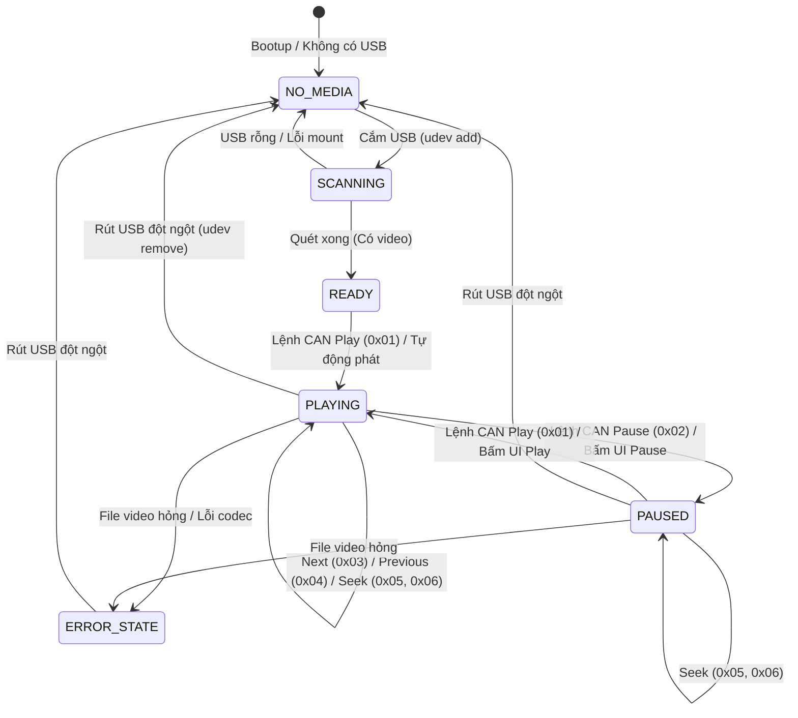

# TÀI LIỆU BASELINE DỰ ÁN VÀ KIẾN THỨC KỸ THUẬT TOÀN DIỆN
# DỰ ÁN: EMBEDDED LINUX USB VIDEO PLAYER CONTROLLED VIA CAN (QT5/QML & ESP32 CAN GATEWAY / CANOE)

> **Mã dự án:** OJT-FASTTRACK-01  
> **Tài liệu tham chiếu:** `Docs/OJT_USB_Video_Player_CAN_Qt5_QML 1 - Copy_1.pptx`  
> **Lĩnh vực:** Embedded Automotive • Linux BSP/Yocto • Driver Development • Qt5/QML HMI • SocketCAN • ESP32 TWAI • Web Dashboard / CANoe  
> **Phiên bản tài liệu:** v1.1.0 (Release Baseline - ESP32 CAN Gateway Redesign)  

---

## MỤC LỤC
1. [Tổng Quan Dự Án & Bài Toán Kỹ Thuật](#1-tổng-quan-dự-án--bài-toán-kỹ-thuật)
2. [Kiến Trúc Hệ Thống Toàn Diện (System Architecture)](#2-kiến-trúc-hệ-thống-toàn-diện-system-architecture)
3. [Thiết Kế Nền Tảng Yocto Linux (Yocto BSP & Distribution Baseline)](#3-thiết-kế-nền-tảng-yocto-linux-yocto-bsp--distribution-baseline)
4. [Work Package A: CAN Controller Driver & SocketCAN Bring-up](#4-work-package-a-can-controller-driver--socketcan-bring-up)
5. [Work Package B: Porting Qt5 & Multimedia GStreamer Stack](#5-work-package-b-porting-qt5--multimedia-gstreamer-stack)
6. [Work Package C: Ứng Dụng HMI Qt5/QML & USB Media Scanner](#6-work-package-c-ứng-dụng-hmi-qt5qml--usb-media-scanner)
7. [Đặc Tả Giao Thức CAN & Thiết Kế DBC (CAN Protocol & DBC Specification)](#7-đặc-tả-giao-thức-can--thiết-kế-dbc-can-protocol--dbc-specification)
8. [Mô Phỏng & Điều Khiển Bằng ESP32 CAN Gateway & Web Dashboard (ESP32 Automotive Simulator)](#8-mô-phỏng--điều-khiển-bằng-esp32-can-gateway--web-dashboard-esp32-automotive-simulator)
9. [Cấu Trúc Thư Mục Source Code Chuẩn Công Nghiệp (Repository Structure)](#9-cấu-trúc-thư-mục-source-code-chuẩn-công-nghiệp-repository-structure)
10. [Kế Hoạch Thực Hiện, Phân Công Nhóm OJT & Tiêu Chí Nghiệm Thu](#10-kế-hoạch-thực-hiện-phân-công-nhóm-ojt--tiêu-chí-nghiệm-thu)

---

## 1. TỔNG QUAN DỰ ÁN & BÀI TOÁN KỸ THUẬT

### 1.1 Bối Cảnh Thực Tế Trong Ngành Automotive
Trong kiến trúc phần mềm ô tô hiện đại (Automotive E/E Architecture), hệ thống **In-Vehicle Infotainment (IVI)** và **Bảng đồng hồ kỹ thuật số (Digital Instrument Cluster)** không hoạt động biệt lập. Chúng liên tục giao tiếp với các hộp điều khiển trung tâm (Gateway ECU, Body Control Module - BCM, Steering Wheel Switches) thông qua mạng truyền thông trên xe, phổ biến nhất là **CAN (Controller Area Network)**.

Đề tài **"USB Video Player Controlled via CAN"** tái hiện một chu trình kỹ thuật hoàn chỉnh (End-to-End Automotive Product Development):
- **Phía Phương tiện & Giả lập Điều khiển (Vehicle Gateway & Control Node):** Thay vì phụ thuộc hoàn toàn vào hệ thống máy trạm và bản quyền đắt đỏ của Vector CANoe (vốn khó tiếp cận trong môi trường Lab/OJT/Di động), dự án thiết kế một nút điều khiển phần cứng độc lập **ESP32 CAN Gateway Simulator** (sử dụng ngoại vi phần cứng **TWAI - Two-Wire Automotive Interface** kết hợp transceiver 3.3V SN65HVD230). Node ESP32 này đóng vai trò Body Control Module / Steering Wheel Gateway, đồng thời tích hợp **Embedded Web Dashboard thời gian thực (qua Wi-Fi SoftAP / WebSockets)** cho phép điều khiển trực tiếp từ bất kỳ Smartphone, Tablet hay Laptop nào mà không cần cài đặt phần mềm. Ngoài ra, hệ thống vẫn duy trì 100% tính tương thích với chuẩn CAN Database (.dbc) để có thể kết nối song song với Vector CANoe / SavvyCAN khi cần đo kiểm chuyên sâu.
- **Phía Thiết bị IVI (Linux Target):** Một bo mạch nhúng (Raspberry Pi / Linux Target) chạy hệ điều hành Embedded Linux (Yocto Kirkstone) được cấu hình chuẩn xác, tự động nhận diện thiết bị lưu trữ ngoài (USB Drive), quét media đệ quy, hiển thị video độ phân giải cao bằng **Qt5/QML** thông qua backend giải mã **GStreamer**, đồng thời nhận diện và phản hồi tức thời các lệnh CAN qua SocketCAN.

### 1.2 Mục Tiêu Đào Tạo & Đánh Giá OJT
Dự án được thiết kế để đánh giá toàn diện năng lực của kỹ sư nhúng từ tầng Low-level phần cứng tới tầng High-level HMI:
1. **Low-level Platform:** Khả năng cấu hình Device Tree (DTS), Linux Kernel Driver (SPI, Interrupts, Clocks), và SocketCAN framework trên Target Raspberry Pi.
2. **Build System & BSP:** Khả năng làm chủ hệ thống Yocto Project, tùy biến layer, image recipe, toolchain cross-compile.
3. **Application & Framework:** Khả năng lập trình C++ hiện đại, lập trình đa luồng (multi-threading), event loop, Qt5 Core, Qt Multimedia, GStreamer pipeline, và giao tiếp udev hotplug.
4. **HMI & User Experience:** Xây dựng giao diện QML mượt mà, layout đáp ứng, quản lý trạng thái phát, animation, touch/mouse handling.
5. **Automotive Networking & Hardware Simulation:** Kỹ năng phân tích giao thức CAN, thiết kế Database CAN (.dbc), lập trình driver TWAI trên vi điều khiển ESP32, xây dựng Web Dashboard HMI thời gian thực và kịch bản kiểm thử tích hợp tự động.

### 1.3 Ma Trận Đầu Vào (Input) & Đầu Ra (Output)

| Phân loại | Thành phần | Mô tả chi tiết |
| :--- | :--- | :--- |
| **Đầu vào (Inputs)** | **Hardware Target** | Raspberry Pi 3/4 / Pi Compute Module (hoặc NXP i.MX6/8) chạy kiến trúc ARM 64-bit. |
| | **Target CAN Hardware** | CAN Controller MCP2515 giao tiếp qua bus SPI + CAN Transceiver (TJA1050 / SN65HVD230) kết nối chân GPIO/SPI của Target. Trở đầu cuối 120Ω. |
| | **USB Storage** | USB 2.0/3.0 format FAT32 / exFAT / ext4 chứa các video test định dạng `.mp4`, `.mkv` (video codec H.264, audio AAC/MP3). |
| | **Gateway / Control Node** | **Bo mạch ESP32** (ESP32 DevKit V1 / NodeMCU) + **CAN Transceiver SN65HVD230 (3.3V)** đóng vai trò Gateway ECU / Steering Wheel Switch. |
| | **Control & HMI Interface** | **Responsive Web Dashboard** (chạy trên Smartphone / Tablet / Laptop qua Wi-Fi Hotspot của ESP32, kết nối WebSocket thời gian thực) + Tùy chọn nút bấm vật lý vô lăng (SWC Pins). Hỗ trợ kiểm thử song song với Vector CANoe / SavvyCAN. |
| **Đầu ra (Deliverables)** | **CAN Driver (can0)** | Giao diện mạng `can0` SocketCAN hoạt động ổn định ở bitrate 500 kbps, tự khôi phục sau Bus-off. |
| | **HMI Player (Qt5/QML)** | Ứng dụng chạy trực tiếp trên framebuffer/EGLFS hoặc Wayland, tự động khởi động cùng hệ thống (systemd service). |
| | **USB Automount & Scan** | Tự động detect khi cắm USB, mount thư mục, quét media đệ quy, tự động nạp playlist và bắt đầu phát. Xử lý an toàn khi rút USB đột ngột. |
| | **CAN Control & Feedback** | Nhận và xử lý 6 lệnh điều khiển từ ESP32 Web Dashboard (Play, Pause, Next, Prev, Fast Forward, Backward). Gửi phản hồi trạng thái phát định kỳ 100ms. |
| | **ESP32 Firmware & Web HMI** | Mã nguồn Firmware ESP32 điều khiển CAN TWAI, Web Server nhúng, Web Dashboard Glassmorphism, và tài liệu hướng dẫn đấu nối. |
| | **Tài liệu & Test Package** | File thiết kế DBC, source code đầy đủ, kịch bản test tự động, tài liệu Build/Deployment, và Test Report có minh chứng log. |

---

## 2. KIẾN TRÚC HỆ THỐNG TOÀN DIỆN (SYSTEM ARCHITECTURE)

### 2.1 Sơ Đồ Khối Phân Tầng (4-Tier Architecture)

```
+-----------------------------------------------------------------------------------+
|               SIMULATION & VEHICLE GATEWAY TIER (ESP32 & WEB DASHBOARD)           |
|                                                                                   |
|   +------------------------------------+   +----------------------------------+   |
|   |  Responsive Web HMI Dashboard      |   |  Physical Controls (Optional)    |   |
|   |  (Phone / Tablet / PC Browser)     |   |  - Steering Wheel Pushbuttons    |   |
|   |  - Play / Pause / Seek Controls    |   |  - Rotary Encoder Volume/Track   |   |
|   |  - Real-time Gauges & CAN Sniffer  |   |                                  |   |
|   +-----------------+------------------+   +-----------------+----------------+   |
|                     | Wi-Fi (WebSockets / HTTP REST)         | GPIO Interrupts    |
|                     +-------------------+--------------------+                    |
|                                         |                                         |
|                     +-------------------v--------------------+                    |
|                     | ESP32 SoC (TWAI / CAN Controller Node) |                    |
|                     | - FreeRTOS Multi-Tasking Architecture  |                    |
|                     | - TWAI Driver @ 500 kbps (ISO 11898-1) |                    |
|                     | - Auto CRC & Rolling Counter Packing   |                    |
|                     | - CAN ID 0x101 Telemetry Broadcaster   |                    |
|                     +-------------------+--------------------+                    |
|                                         |                                         |
|                     [SN65HVD230 3.3V CAN Transceiver Module]                      |
+-----------------------------------------|-----------------------------------------+
                                          |
                               CAN Physical Bus (ISO 11898-2, 500 kbps)
                               120 Ohm Termination Resistors at both ends
                               Common GND between ESP32 and Target
                                          |
+-----------------------------------------|-----------------------------------------+
|                                LINUX TARGET TIER                                  |
|                                                                                   |
|   [MCP2515 Transceiver / Controller] <-> [SPI Bus + GPIO IRQ / Raspberry Pi]      |
|                                                                                   |
|   +---------------------------------------------------------------------------+   |
|   |                           KERNEL & DRIVER LAYER                           |   |
|   |   - Device Tree Overlay (mcp2515-can0.dtbo)                               |   |
|   |   - SPI Master Driver (spi-bcm2835)                                       |   |
|   |   - CAN Controller Driver (mcp251x.ko)                                    |   |
|   |   - Linux Network Subsystem: SocketCAN Framework -> can0 Network Netdev   |   |
|   |   - USB Core Subsystem: Mass Storage Driver -> /dev/sdX                   |   |
|   +-------------------------------------+-------------------------------------+   |
|                                         |                                         |
|   +-------------------------------------+-------------------------------------+   |
|   |                            OS SERVICES LAYER                              |   |
|   |   - udev subsystem / systemd-udevd: USB Hotplug detection                 |   |
|   |   - Automount Service: Dynamic mount USB to /media/usb0                   |   |
|   |   - SocketCAN Network Config: systemd-networkd / setup_can.sh             |   |
|   +------------------+------------------------------------+-------------------+   |
|                      |                                    |                       |
|   +------------------+------------------------------------+-------------------+   |
|   |                          APPLICATION LAYER                                |   |
|   |                                                                           |   |
|   |   +-----------------------+     +-------------------------------------+   |   |
|   |   |    CAN Service Thread |     |          USB Monitor Worker         |   |   |
|   |   |  - Native SocketCAN / |     |  - libudev / QFileSystemWatcher     |   |   |
|   |   |    QCanBus Socket     |     |  - Recursive Directory Media Scan   |   |   |
|   |   |  - Parse ID 0x100 CMD |     |  - Auto-generate Playlist Model     |   |   |
|   |   |  - Send ID 0x101 STAT |     |  - Safe Unmount & Error Detection   |   |   |
|   |   +-----------+-----------+     +------------------+------------------+   |   |
|   |               |                                    |                      |   |
|   |               +-----------------+------------------+                      |   |
|   |                                 |                                         |   |
|   |                   +-------------v---------------+                         |   |
|   |                   |    Player Controller (C++)  |                         |   |
|   |                   |  - Finite State Machine     |                         |   |
|   |                   |  - Playback / Seek Logic    |                         |   |
|   |                   |  - Status Aggregator        |                         |   |
|   |                   +-------------+---------------+                         |   |
|   |                                 |                                         |   |
|   |   +-----------------------------v-------------------------------------+   |   |
|   |   |                     Qt5/QML HMI & MULTIMEDIA                      |   |   |
|   |   |  - QML Frontend: VideoSurface, Playlist View, Control Bar, Overlay|   |   |
|   |   |  - Backend: QtMultimedia (QMediaPlayer / QMediaPlaylist)          |   |   |
|   |   |  - Video Engine: GStreamer 1.0 Pipeline (playbin / v4l2codecs)    |   |   |
|   |   |  - Graphics Display: EGLFS (KMS/DRM Direct Rendering)             |   |   |
|   |   +-------------------------------------------------------------------+   |   |
+-----------------------------------------------------------------------------------+
```

### 2.2 Luồng Dữ Liệu & Điều Khiển (Data & Control Flow)

#### A. Luồng Cắm/Rút USB (USB Hotplug & Media Discovery Flow)
1. Người dùng cắm USB vào cổng vật lý của Target.
2. Kernel USB Core phát hiện phần cứng, tạo block device `/dev/sda1`.
3. Daemon `systemd-udevd` kích hoạt rule udev, tự động mount phân vùng vào `/media/usb0`.
4. Lớp `UsbMonitor` trong ứng dụng (sử dụng `libudev` qua socket Netlink hoặc `QFileSystemWatcher`) nhận tín hiệu mount.
5. Luồng worker quét đệ quy (Recursive Scanner) toàn bộ cây thư mục trên `/media/usb0`, lọc các file có phần mở rộng `.mp4`, `.mkv`, `.avi`.
6. Cập nhật danh sách vào `PlaylistModel` (C++ `QAbstractListModel`), tự động highlight video đầu tiên và chuyển trạng thái sang `READY` hoặc tự động `PLAY`.
7. Khi rút USB đột ngột: udev kích hoạt sự kiện `remove`, `UsbMonitor` phát hiện unmount, lập tức ngắt pipeline phát của `QMediaPlayer`, reset `PlaylistModel`, hiển thị cảnh báo "USB Disconnected" trên QML và phát tán cờ `USB_ERROR` qua CAN ID `0x101`.

#### B. Luồng Nhận Lệnh Điều Khiển Từ ESP32 Web Dashboard (CAN Command Flow)
1. Người dùng bấm nút trên Web Dashboard (trên smartphone/laptop qua Wi-Fi) hoặc bấm phím cứng vô lăng (SWC Pin) nối vào ESP32.
2. Web Dashboard gửi event WebSocket dạng JSON (ví dụ: `{"cmd": "PLAY"}` hoặc `{"cmd": "SEEK_FWD", "val": 10}`) tới ESP32.
3. Firmware ESP32 tiếp nhận, tăng `Rolling Counter (0..15)`, tính toán `Checksum` modulo 256 theo đúng công thức đặc tả CAN DBC, đóng gói frame CAN ID `0x100`.
4. Bộ điều khiển phần cứng TWAI của ESP32 phát frame ra đường truyền vi sai qua transceiver SN65HVD230 ở bitrate 500 kbps.
5. Controller MCP2515 trên Target Raspberry Pi nhận frame, kích hoạt chân ngắt INT nối vào GPIO.
6. Linux Kernel Driver `mcp251x` đọc dữ liệu qua bus SPI, chuyển thành struct `can_frame` trong tầng SocketCAN.
7. Luồng `CanService` của ứng dụng C++ đang lắng nghe trên socket `PF_CAN` (hoặc `QCanBus`) nhận frame.
8. `CanService` kiểm tra tính toàn vẹn: Xác thực Checksum và Rolling Counter. Nếu hợp lệ, giải mã Byte 0 và Byte 1, gọi hàm xử lý tương ứng trên `PlayerController` (`play()`, `pause()`, `seekForward()`).
9. `PlayerController` tác động vào `QMediaPlayer`, cập nhật vị trí video, đồng thời phát tín hiệu `Q_PROPERTY` cập nhật giao diện QML.

#### C. Luồng Phản Hồi Trạng Thái Về ESP32 Web Dashboard (CAN Status Feedback Flow)
1. Bộ đếm định thời Timer (100ms) trong `CanService` trên Target Raspberry Pi kích hoạt chu kỳ truyền.
2. `PlayerController` trích xuất thông tin hiện thời: Trạng thái phát (Playing/Paused/Stopped), Vị trí hiện tại (Current Time), Tổng thời lượng (Total Duration), Mã lỗi, Trạng thái USB.
3. Đóng gói dữ liệu thành frame CAN ID `0x101`, tăng Alive Counter của Status Frame.
4. Ghi frame vào SocketCAN thông qua lời gọi `write(sock, &frame, sizeof(frame))`.
5. Transceiver SN65HVD230 và bộ điều khiển TWAI của ESP32 nhận frame qua ngắt phần cứng.
6. Firmware ESP32 unpack frame `0x101`, chuyển đổi các trường dữ liệu thành gói tin JSON Telemetry:
   `{"state":1,"curTime":145,"totalTime":320,"usb":2,"alive":77}`
7. ESP32 phát tán (broadcast) gói tin qua WebSocket tới toàn bộ các client Web Dashboard đang mở.
8. Web Dashboard cập nhật mượt mà thanh tiến trình video, đồng hồ hiển thị (`02:25 / 05:20`), đèn LED trạng thái phát và đèn báo USB theo thời gian thực (độ trễ < 10ms).

---

## 3. THIẾT KẾ NỀN TẢNG YOCTO LINUX (YOCTO BSP & DISTRIBUTION BASELINE)

### 3.1 Đánh Giá & Lựa Chọn Phiên Bản Yocto: Vì Sao Chọn Yocto 4.0 LTS (Kirkstone)?

Trong các dự án Linux nhúng ô tô, việc chọn phiên bản Yocto quyết định sự tương thích của Toolchain, Linux Kernel, và đặc biệt là bộ thư viện đồ họa **Qt5**.

| Tiêu chí | Yocto 3.1 LTS (Dunfell) | **Yocto 4.0 LTS (Kirkstone) [CHỌN]** | Yocto 5.0 LTS (Scarthgap) |
| :--- | :--- | :--- | :--- |
| **Trạng thái hỗ trợ** | EOL (Hết hạn hỗ trợ) | **Active LTS (Ổn định công nghiệp cao)** | Active LTS (Phiên bản mới nhất) |
| **Linux Kernel** | 5.4 | **5.15 LTS / 6.1 LTS** | 6.6 LTS |
| **Hỗ trợ Qt5 (`meta-qt5`)** | Tốt (Qt 5.14/5.15) | **Xuất sắc (Qt 5.15 LTS upstream)** | **Đã Deprecated / Hạn chế** |
| **GStreamer Stack** | 1.16 | **1.20 (Tối ưu HW Decode cực tốt)** | 1.22 |
| **SocketCAN Framework** | Đầy đủ | **Đầy đủ, sửa lỗi driver mcp251x** | Đầy đủ |
| **Tính tương thích Pi** | Pi 3 tốt, Pi 4 cơ bản | **Hoàn hảo cho Raspberry Pi 3, 4, CM4** | Cần nhiều patch tương thích |

> **QUYẾT ĐỊNH KỸ THUẬT (BASELINE DECISION):**  
> Dự án chọn **Yocto Project 4.0 LTS (Kirkstone)** làm chuẩn nền tảng vì:
> 1. `meta-qt5` trên nhánh **Kirkstone** là nhánh ổn định nhất của Qt 5.15 LTS. Kể từ Yocto 4.2+ (Mickledore) và 5.0 (Scarthgap), cộng đồng Yocto đã chuyển trọng tâm sang Qt6 (`meta-qt6`), việc ép dùng Qt5 trên Scarthgap sẽ gặp rất nhiều lỗi biên dịch cú pháp và thiếu gói tương thích.
> 2. GStreamer 1.20 trên Kirkstone hoạt động cực kỳ mượt mà với plugin `v4l2codecs` và cơ chế DRM/KMS không cần Desktop Environment.
> 3. Driver `mcp251x` trong Kernel 5.15 LTS của Kirkstone có cơ chế ngắt bằng luồng (threaded IRQ) hoàn thiện, giảm thiểu tối đa hiện tượng tràn bộ đệm SPI khi nhận frame dồn dập từ CANoe.

### 3.2 Cấu Trúc Các Layer Yocto Cần Thiết
Để build image cho bo mạch Raspberry Pi với Qt5 và Multimedia, cây cấu hình layer phải bao gồm các kho sau (tất cả đều checkout branch `kirkstone`):

```
yocto-kirkstone/
├── poky/                          # Yocto Core Distribution & BitBake
├── meta-openembedded/
│   ├── meta-oe/                   # Các thư viện & công cụ bổ trợ
│   ├── meta-multimedia/           # Thư viện codec và GStreamer mở rộng
│   └── meta-networking/           # Tiện ích mạng & SocketCAN
├── meta-raspberrypi/              # BSP layer cho Raspberry Pi
├── meta-qt5/                      # Công cụ và runtime Qt 5.15 LTS
└── meta-fasttrack/                # Custom layer riêng của dự án
    ├── recipes-bsp/               # Device Tree overlay & boot config
    ├── recipes-kernel/            # Kernel config fragments (.cfg)
    ├── recipes-multimedia/        # Tùy biến GStreamer recipes
    └── recipes-apps/              # Recipe build ứng dụng QML Video Player
```

### 3.3 Cấu Hình `bblayers.conf` Chuẩn

```bitbake
# POKY_BBLAYERS_CONF_VERSION is increased each time build/conf/bblayers.conf
# changes incompatibly
POKY_BBLAYERS_CONF_VERSION = "2"

BBPATH = "${TOPDIR}"
BBFILES ?= ""

BBLAYERS ?= " \
  ${TOPDIR}/../poky/meta \
  ${TOPDIR}/../poky/meta-poky \
  ${TOPDIR}/../poky/meta-yocto-bsp \
  ${TOPDIR}/../meta-openembedded/meta-oe \
  ${TOPDIR}/../meta-openembedded/meta-multimedia \
  ${TOPDIR}/../meta-openembedded/meta-networking \
  ${TOPDIR}/../meta-raspberrypi \
  ${TOPDIR}/../meta-qt5 \
  ${TOPDIR}/../meta-fasttrack \
  "
```

### 3.4 Cấu Hình `local.conf` Tối Ưu Cho Automotive IVI Target
Cấu hình dưới đây loại bỏ hoàn toàn hệ thống cửa sổ cồng kềnh (X11 và Wayland), cấu hình Qt5 chạy thẳng trên nền **EGLFS (KMS/DRM)**, giúp thời gian khởi động (Boot Time) đạt dưới 8 giây và tiết kiệm tối đa RAM/CPU:

```bitbake
# --- Hardware Target ---
MACHINE = "raspberrypi4-64"
# Hoặc "raspberrypi3-64" tùy thuộc bo mạch thực tế của OJT

# --- Kiến trúc Hệ điều hành & Khởi động ---
DISTRO = "poky"
DISTRO_FEATURES:append = " systemd pam opengl kms eglfs"
DISTRO_FEATURES:remove = " x11 wayland vulkan 3g nfc"

# Sử dụng systemd làm init manager
INIT_MANAGER = "systemd"

# --- Tối ưu hóa GPU & Video Buffer trên Raspberry Pi ---
GPU_MEM = "256"
ENABLE_CAN = "1"
ENABLE_SPI = "1"

# Khai báo nạp Device Tree Overlay cho MCP2515 (Oscillator 8MHz hoặc 16MHz)
RPI_EXTRA_CONFIG = " \
    dtoverlay=mcp2515-can0,oscillator=16000000,interrupt=25 \
    dtoverlay=spi-bcm2835 \
    hdmi_force_hotplug=1 \
    hdmi_group=2 \
    hdmi_mode=82 \
"

# --- Cài đặt Qt5 & Platform Plugins ---
PACKAGECONFIG_FONTS:append:pn-qtbase = " fontconfig"
PACKAGECONFIG:append:pn-qtbase = " eglfs kms gbm gstreamer libinput"
PACKAGECONFIG:remove:pn-qtbase = " x11"

# --- Các gói phần mềm cài đặt vào Image (IMAGE_INSTALL) ---
IMAGE_INSTALL:append = " \
    packagegroup-core-boot \
    systemd-analyze \
    \
    /* SocketCAN Utilities */ \
    can-utils \
    iproute2 \
    libsocketcan \
    \
    /* USB Storage & Filesystems */ \
    udev-extraconf \
    e2fsprogs \
    dosfstools \
    ntfs-3g \
    exfat-utils \
    usbutils \
    \
    /* GStreamer Multimedia Stack */ \
    gstreamer1.0 \
    gstreamer1.0-plugins-base \
    gstreamer1.0-plugins-good \
    gstreamer1.0-plugins-bad \
    gstreamer1.0-plugins-ugly \
    gstreamer1.0-libav \
    gstreamer1.0-omx \
    \
    /* Qt5 Runtime & Modules */ \
    qtbase \
    qtbase-plugins \
    qtdeclarative \
    qtdeclarative-qmlplugins \
    qtquickcontrols2 \
    qtmultimedia \
    qtmultimedia-plugins \
    qtmultimedia-qmlplugins \
    qtserialbus \
    ttf-dejavu-sans \
    \
    /* Ứng dụng chính của dự án */ \
    fasttrack-video-player \
"

# Tối ưu dung lượng & build flags
IMAGE_FSTYPES = "wic.bz2 wic.bmap"
PACKAGE_CLASSES = "package_rpm"
EXTRA_IMAGE_FEATURES = "debug-tweaks ssh-server-openssh"
```

### 3.5 Recipe Đóng Gói Ứng Dụng Qt5 (`fasttrack-video-player_1.0.bb`)
Recipe mẫu nằm trong `meta-fasttrack/recipes-apps/fasttrack-video-player/fasttrack-video-player_1.0.bb`:

```bitbake
SUMMARY = "Automotive USB Video Player Controlled via CAN"
DESCRIPTION = "Qt5/QML In-Vehicle Infotainment Media Player with SocketCAN Interface"
HOMEPAGE = "https://github.com/fasttrack/fasttrack-video-player"
LICENSE = "MIT"
LIC_FILES_CHKSUM = "file://${COMMON_LICENSE_DIR}/MIT;md5=0835ade698e0bcf8506ecda2f7b4f302"

DEPENDS = "qtbase qtdeclarative qtmultimedia qtserialbus gstreamer1.0 udev"

SRC_URI = " \
    file://src/ \
    file://fasttrack-video-player.service \
    file://setup_can.sh \
"

S = "${WORKDIR}/src"

inherit qmake5 systemd

SYSTEMD_SERVICE:${PN} = "fasttrack-video-player.service"
SYSTEMD_AUTO_ENABLE = "enable"

do_install() {
    install -d ${D}${bindir}
    install -m 0755 fasttrack-video-player ${D}${bindir}/fasttrack-video-player
    
    install -d ${D}${bindir}
    install -m 0755 ${WORKDIR}/setup_can.sh ${D}${bindir}/setup_can.sh

    install -d ${D}${systemd_system_unitdir}
    install -m 0644 ${WORKDIR}/fasttrack-video-player.service ${D}${systemd_system_unitdir}/
}

FILES:${PN} += "${bindir}/* ${systemd_system_unitdir}/*"
RDEPENDS:${PN} += "qtbase-plugins qtdeclarative-qmlplugins qtmultimedia-plugins gstreamer1.0-plugins-good"
```

### 3.6 Cấu Hình Systemd Service Khởi Chạy Tự Động (`fasttrack-video-player.service`)

```ini
[Unit]
Description=Automotive USB Video Player IVI Service
After=network.target systemd-udevd.service sound.target
Wants=sound.target

[Service]
Type=simple
Environment=QT_QPA_PLATFORM=eglfs
Environment=QT_QPA_EGLFS_KMS_CONFIG=/etc/kms.conf
Environment=QT_QPA_EGLFS_ALWAYS_SET_MODE=1
Environment=XDG_RUNTIME_DIR=/run/user/0
ExecStartPre=/usr/bin/setup_can.sh
ExecStart=/usr/bin/fasttrack-video-player
Restart=on-failure
RestartSec=3s
KillMode=process

[Install]
WantedBy=multi-user.target
```

---

## 4. WORK PACKAGE A: CAN CONTROLLER DRIVER & SOCKETCAN BRING-UP

### 4.1 Lựa Chọn & Đấu Nối Phần Cứng
- **Controller:** Chip MCP2515 (Microchip) giao tiếp chuẩn SPI Mode (0,0), hỗ trợ CAN 2.0B Active (tốc độ tối đa 1 Mbps).
- **Transceiver:** Chip TJA1050 (NXP) hoặc SN65HVD230 (TI - hỗ trợ logic 3.3V trực tiếp cho Raspberry Pi).
- **Oscillator (Thạch anh):** Phổ biến loại **8.000 MHz** hoặc **16.000 MHz**. Cực kỳ quan trọng: Nếu khai báo sai tần số thạch anh trong Device Tree, bitrate tính toán sẽ bị sai lệch hoàn toàn dẫn đến lỗi Bus-off ngay khi kết nối.

**Sơ đồ chân kết nối vật lý (Pinout Raspberry Pi Header 40 chân <-> MCP2515 Board):**
- `VCC` -> 3.3V (Pin 1) hoặc 5V (Pin 2 tùy module)
- `GND` -> GND (Pin 6)
- `CS`  -> GPIO 8 (SPI0_CE0_N - Pin 24)
- `SO` (MISO) -> GPIO 9 (SPI0_MISO - Pin 21)
- `SI` (MOSI) -> GPIO 10 (SPI0_MOSI - Pin 19)
- `SCK` (SCLK) -> GPIO 11 (SPI0_SCLK - Pin 23)
- `INT` (Interrupt) -> GPIO 25 (Pin 22)

### 4.2 Thiết Kế Device Tree Overlay (`mcp2515-can0-overlay.dts`)

```dts
/dts-v1/;
/plugin/;

/ {
    compatible = "brcm,bcm2835";

    fragment@0 {
        target = <&spidev0>;
        __overlay__ {
            status = "disabled";
        };
    };

    fragment@1 {
        target = <&gpio>;
        __overlay__ {
            can0_pins: can0_pins {
                brcm,pins = <25>;
                brcm,function = <0>; /* Input */
                brcm,pull = <2>;     /* Pull-up */
            };
        };
    };

    fragment@2 {
        target-path = "clocks";
        __overlay__ {
            can0_osc: can0_osc {
                compatible = "fixed-clock";
                #clock-cells = <0>;
                clock-frequency = <16000000>; /* Đặt 16MHz hoặc 8MHz đúng với thạch anh trên board */
            };
        };
    };

    fragment@3 {
        target = <&spi0>;
        __overlay__ {
            #address-cells = <1>;
            #size-cells = <0>;
            status = "okay";

            can0: mcp2515@0 {
                compatible = "microchip,mcp2515";
                reg = <0>; /* CS 0 */
                pinctrl-names = "default";
                pinctrl-0 = <&can0_pins>;
                spi-max-frequency = <10000000>;
                interrupt-parent = <&gpio>;
                interrupts = <25 0x2>; /* GPIO 25, Falling Edge Trigger (IRQ_TYPE_EDGE_FALLING) */
                clocks = <&can0_osc>;
                status = "okay";
            };
        };
    };
};
```

### 4.3 Cấu Hình Kernel Linux (`defconfig` / `.cfg`)
Để kích hoạt đầy đủ stack SocketCAN, kernel cần được kích hoạt các flags sau:

```ini
# Networking Support -> CAN Bus Subsystem Support
CONFIG_CAN=y
CONFIG_CAN_RAW=y
CONFIG_CAN_BCM=y
CONFIG_CAN_GW=y

# CAN Device Drivers
CONFIG_CAN_DEV=y
CONFIG_CAN_CALC_BITTIMING=y
CONFIG_CAN_MCP251X=m

# SPI Master Controller Driver
CONFIG_SPI=y
CONFIG_SPI_BCM2835=y
```

### 4.4 Script Khởi Tạo SocketCAN Tự Phục Hồi (`setup_can.sh`)
Script này đảm bảo thiết lập bitrate chuẩn **500 kbps** (tương thích CANoe) và kích hoạt cơ chế `restart-ms 100` để tự động hồi phục khi bị bus-off do cắm rút dây hoặc xung đột truyền thông:

```bash
#!/bin/sh
set -e

CAN_INTERFACE="can0"
CAN_BITRATE="500000"
RESTART_MS="100"

echo "[CAN_INIT] Kiểm tra thiết bị $CAN_INTERFACE..."

# Đảm bảo kernel module đã được nạp
if ! lsmod | grep -q "mcp251x"; then
    modprobe mcp251x || true
fi

# Tắt interface nếu đang bật dở
if ip link show "$CAN_INTERFACE" 2>/dev/null | grep -q "UP"; then
    echo "[CAN_INIT] Hạ interface $CAN_INTERFACE để cấu hình lại..."
    ip link set "$CAN_INTERFACE" down
fi

# Cấu hình bitrate và restart tự động sau bus-off
echo "[CAN_INIT] Cấu hình $CAN_INTERFACE: Bitrate=$CAN_BITRATE bps, Auto-Restart=$RESTART_MS ms"
ip link set "$CAN_INTERFACE" type can bitrate "$CAN_BITRATE" restart-ms "$RESTART_MS"

# Nâng interface lên
ip link set "$CAN_INTERFACE" up

# Cấu hình kích thước hàng đợi truyền (txqueuelen) để tránh drop frame khi truyền dày đặc
ip link set "$CAN_INTERFACE" txqueuelen 1000

echo "[CAN_INIT] $CAN_INTERFACE đã sẵn sàng hoạt động!"
ip -details link show "$CAN_INTERFACE"
```

### 4.5 Phương Pháp Kiểm Chứng & Troubleshooting Driver
1. **Kiểm tra phát hiện phần cứng trong dmesg:**
   ```bash
   dmesg | grep -i -E "spi|mcp2515|can0"
   # Kỳ vọng: mcp251x spi0.0 can0: MCP2515 successfully initialized.
   ```
2. **Kiểm tra trạng thái interface và thống kê lỗi:**
   ```bash
   ip -details -statistics link show can0
   # Chú ý các chỉ số: state ERROR-ACTIVE / BUS-OFF, rx errors, tx errors
   ```
3. **Thử nghiệm gửi frame từ Target:**
   ```bash
   cansend can0 101#0102000000000000
   ```
4. **Thử nghiệm nhận frame từ CANoe:**
   ```bash
   candump -td -c -x can0
   ```
5. **Khắc phục lỗi thường gặp:**
   - **Lỗi `Cannot find device can0`:** Kiểm tra dây SPI/CS/INT, kiểm tra `config.txt` đã nạp overlay chưa.
   - **Lỗi nhận toàn frame lỗi (Stuff Error / CRC Error) hoặc Bus-off ngay khi kết nối CANoe:** Khai báo sai tần số thạch anh (ví dụ: board dùng thạch anh 8MHz nhưng khai báo 16MHz trong DTS) hoặc thiếu trở đầu cuối 120Ω.

---

## 5. WORK PACKAGE B: PORTING QT5 & MULTIMEDIA GSTREAMER STACK

### 5.1 Kiến Trúc Qt5 Runtime & Platform Plugin EGLFS
Trong hệ thống nhúng ô tô, việc khởi động qua một trình quản lý cửa sổ như X11 hoặc Wayland/Weston làm tiêu tốn từ 100MB - 300MB RAM và tăng thời gian khởi động thêm 4-10 giây.
Dự án chọn **EGLFS (EGL Full Screen)** plugin:
- EGLFS render trực tiếp các khung hình OpenGL ES lên bề mặt DRM/KMS framebuffer của chip đồ họa VideoCore (trên Raspberry Pi).
- Biến môi trường bắt buộc:
  ```bash
  export QT_QPA_PLATFORM=eglfs
  export QT_QPA_EGLFS_ALWAYS_SET_MODE=1
  ```

### 5.2 GStreamer 1.0 Backend Tích Hợp Cho Qt Multimedia
Qt Multimedia sử dụng backend `gstreamer-1.0` để giải mã luồng video. Cấu hình pipeline nội bộ của Qt `QMediaPlayer` tương đương với pipeline `playbin`:

```
filesrc (file:///media/usb0/video.mp4) 
  -> qtdemux 
    -> h264parse 
      -> v4l2h264dec (Hardware) hoặc avdec_h264 (Software) 
        -> videoconvert 
          -> qtvideosink / waylandsink / kmssink 
            -> Render ra bề mặt QML VideoOutput
```

**Thử nghiệm pipeline GStreamer độc lập trên console trước khi tích hợp vào Qt:**
```bash
gst-launch-1.0 filesrc location=/media/usb0/test.mp4 ! \
    qtdemux name=demux demux.video_0 ! \
    queue ! h264parse ! avdec_h264 ! \
    videoconvert ! autovideosink
```

### 5.3 Chỉ Số Chấp Thuận Kỹ Thuật (Acceptance Benchmark)
- **Tải CPU khi phát video 1080p 30fps:** $\le 35\%$ trên Raspberry Pi 4 (với HW decode) hoặc $\le 65\%$ (với SW multi-threaded decode).
- **Mức tiêu hao bộ nhớ (RSS):** Toàn bộ ứng dụng Qt5 không vượt quá **180 MB**.
- **Tính ổn định của RAM (Memory Leak Test):** Phát lặp lại danh sách playlist liên tục trong 4 giờ, biểu đồ RAM không được tăng tuyến tính quá 5% (zero critical memory leak).
- **Thời gian khởi động ứng dụng (Startup Latency):** Từ lúc cấp nguồn đến khi giao diện QML hiển thị frame đầu tiên $\le 8.5$ giây.

---

## 6. WORK PACKAGE C: ỨNG DỤNG HMI QT5/QML & USB MEDIA SCANNER

### 6.1 Cơ Chế Tự Động Nhận Diện USB (udev Automount & Netlink Monitoring)
Ứng dụng C++ không thực hiện quét định kỳ (polling) nhằm tránh tốn tài nguyên I/O. Thay vào đó, lớp `UsbStorageManager` lắng nghe trực tiếp sự kiện từ `libudev` qua socket Netlink của Linux Kernel.

```cpp
// Trích xuất logic giám sát udev trong UsbStorageManager.cpp
#include <libudev.h>
#include <QSocketNotifier>
#include <QDebug>

void UsbStorageManager::initUdevMonitor() {
    struct udev *udevCtx = udev_new();
    struct udev_monitor *mon = udev_monitor_new_from_netlink(udevCtx, "udev");
    udev_monitor_filter_add_match_subsystem_devtype(mon, "block", "partition");
    udev_monitor_enable_receiving(mon);

    int fd = udev_monitor_get_fd(mon);
    QSocketNotifier *notifier = new QSocketNotifier(fd, QSocketNotifier::Read, this);
    connect(notifier, &QSocketNotifier::activated, [this, mon]() {
        struct udev_device *dev = udev_monitor_receive_device(mon);
        if (dev) {
            QString action = udev_device_get_action(dev);
            QString devNode = udev_device_get_devnode(dev);
            if (action == "add") {
                qInfo() << "[UDEV] Phát hiện USB được cắm:" << devNode;
                handleUsbInserted(devNode);
            } else if (action == "remove") {
                qInfo() << "[UDEV] Phát hiện USB bị rút:" << devNode;
                handleUsbRemoved(devNode);
            }
            udev_device_unref(dev);
        }
    });
}
```

### 6.2 Thuật Toán Quét Media Đệ Quy (Recursive Media Scanner)
Khi USB được gắn thành công tại `/media/usb0`, một luồng phụ `QThread` chạy thuật toán `QDirIterator` đệ quy để thu thập toàn bộ video mà không làm nghẽn giao diện đồ họa chính (Main UI Thread):

```cpp
void UsbScannerWorker::scanDirectory(const QString &mountPath) {
    QStringList mediaFiles;
    QStringList filters = {"*.mp4", "*.mkv", "*.avi", "*.mov"};
    QDirIterator it(mountPath, filters, QDir::Files, QDirIterator::Subdirectories);

    while (it.hasNext()) {
        QString filePath = it.next();
        mediaFiles.append(filePath);
    }

    emit scanFinished(mediaFiles);
}
```

### 6.3 Thiết Kế Máy Trạng Thái Trình Phát (Player Finite State Machine)



### 6.4 Thiết Kế Giao Diện QML (Layout & UX Specifications)
Giao diện được thiết kế theo chuẩn màn hình trung tâm ô tô (tỷ lệ 16:9 hoặc 4:3, tông màu tối Dark Automotive Theme chống chói ban đêm):
- **Khu vực Video Chính (Video Canvas):** Chiếm $75\%$ diện tích bên trái, sử dụng thành phần `VideoOutput` hỗ trợ render mượt mà 60 fps.
- **Khu vực Danh Sách Phát (Playlist Drawer):** Chiếm $25\%$ diện tích bên phải, hiển thị danh sách video cuộn mượt. Video đang phát được highlight bằng màu viền xanh cyan rực rỡ (`#00E5FF`) kèm biểu tượng `▶`.
- **Thanh Điều Khiển Dưới Đáy (Bottom Control Bar):**
  - Nút bấm to, khoảng cách an toàn cho thao tác cảm ứng: Prev (`⏮`), Fast Backward (`◀◀`), Play/Pause (`▶ / ⏸`), Fast Forward (`▶▶`), Next (`⏭`).
  - Thanh trượt tiến trình (Progress Bar / Slider) hiển thị: `02:35 / 05:40`.
- **Lớp Phủ Cảnh Báo (Notification & Error Toast):**
  - Hiển thị pop-up đỏ trong suốt: *"⚠️ USB Storage Disconnected! Playback Aborted."* khi rút USB.
  - Hiển thị thông báo vàng: *"⚠️ No playable media found in USB drive"* khi USB không có file.

---

## 7. ĐẶC TẢ GIAO THỨC CAN & THIẾT KẾ DBC (CAN PROTOCOL & DBC SPECIFICATION)

### 7.1 Cấu Trúc Frame CAN ID 0x100: Lệnh Điều Khiển (COMMAND)
- **Tên Message:** `CMD_VideoPlayer`
- **Người gửi (Transmitter):** ESP32 CAN Gateway / CANoe
- **Người nhận (Receiver):** Linux IVI Target (`can0`)
- **DLC:** 8 bytes
- **Chu kỳ truyền:** Event-triggered (khi người dùng bấm trên Web Dashboard / phím SWC) hoặc lặp lại chu kỳ 50ms khi đang giữ nút Fast Forward/Rewind.

| Byte Offset | Tên trường (Signal Name) | Kiểu dữ liệu | Giá trị & Ý nghĩa kỹ thuật |
| :---: | :--- | :---: | :--- |
| **Byte 0** | `Command_ID` | `uint8` | `0x00`: No Action (Idle)<br>`0x01`: Play<br>`0x02`: Pause<br>`0x03`: Next Track<br>`0x04`: Previous Track |
| **Byte 1** | `Seek_Command` | `uint8` | `0x00`: None<br>`0x05`: Fast Forward (+Step)<br>`0x06`: Fast Backward (-Step) |
| **Byte 2** | `Seek_Step_Value` | `uint8` | Bước nhảy thời gian tính bằng giây (`5s`, `10s`, `15s`) hoặc hệ số tốc độ (`2x`, `4x`). |
| **Byte 3** | `Rolling_Counter` | `uint4` (Bits 0..3) | Bộ đếm vòng `0 -> 15`, tăng 1 đơn vị mỗi khi phát lệnh mới. Mục đích: Chống lặp lệnh (Replay attack / Glitch). |
| **Byte 4** | `Checksum` | `uint8` | Giá trị kiểm tra toàn vẹn byte: $Checksum = (B0 + B1 + B2 + B3) \pmod{256}$. |
| **Byte 5..7**| `Reserved` | `uint8[3]` | Mặc định điền `0x00` để dự phòng mở rộng tương lai. |

### 7.2 Cấu Trúc Frame CAN ID 0x101: Phản Hồi Trạng Thái (STATUS)
- **Tên Message:** `STAT_VideoPlayer`
- **Người gửi (Transmitter):** Linux IVI Target (`can0`)
- **Người nhận (Receiver):** ESP32 CAN Gateway / Web Dashboard / CANoe / Display Cluster
- **DLC:** 8 bytes
- **Chu kỳ truyền:** Định kỳ đều đặn **100 ms** (Cyclic Transmission).

| Byte Offset | Tên trường (Signal Name) | Kiểu dữ liệu | Giá trị & Ý nghĩa kỹ thuật |
| :---: | :--- | :---: | :--- |
| **Byte 0** | `Playback_State` | `uint8` | `0x00`: STOPPED / NO_MEDIA<br>`0x01`: PLAYING<br>`0x02`: PAUSED<br>`0x03`: ERROR |
| **Byte 1** | `Current_Track_Index` | `uint8` | Chỉ số video đang phát trong playlist (`0 .. 255`). |
| **Byte 2..3** | `Current_Play_Time` | `uint16_be` | Thời gian phát hiện tại tính bằng giây (`0 .. 65535s`). Big Endian. |
| **Byte 4..5** | `Total_Duration` | `uint16_be` | Tổng thời lượng của video tính bằng giây (`0 .. 65535s`). Big Endian. |
| **Byte 6** | `System_Health_Status`| `uint8` | Bit 0..1 (USB State): `0`: No USB, `1`: Scanning, `2`: Ready<br>Bit 2..3 (Player Error): `0`: OK, `1`: Decode Error, `2`: IO Error |
| **Byte 7** | `Status_Alive_Counter`| `uint8` | Bộ đếm nhịp tim (Heartbeat Counter) `0 .. 255`, tăng mỗi 100ms. |

### 7.3 File Đặc Tả Vector CAN Database (`VideoPlayer_CAN.dbc`)
Đây là nội dung file DBC chuẩn định dạng Vector CANoe, dùng để load trực tiếp vào phần mềm CANoe:

```text
VERSION ""

NS_ : 
    NS_DESC_
    CM_
    BA_DEF_
    BA_
    VAL_
    CAT_DEF_
    CAT_
    FILTER
    BA_DEF_DEF_
    EV_DATA_
    ENVVAR_DATA_
    SGTYPE_
    SGTYPE_VAL_
    BA_DEF_SGTYPE_
    BA_SGTYPE_
    SIG_TYPE_REF_
    VAL_TABLE_
    SIG_GROUP_
    SIG_VALTYPE_
    SIGTYPE_VALTYPE_
    BO_TX_BU_
    BA_DEF_REL_
    BA_REL_
    BA_DEF_DEF_REL_
    BU_SG_REL_
    BU_EV_REL_
    BU_BO_REL_
    SG_MUL_VAL_

BS_:

BU_: CANOE_GW TARGET_IVI

BO_ 256 CMD_VideoPlayer: 8 CANOE_GW
 SG_ Command_ID : 0|8@1+ (1,0) [0|4] "" TARGET_IVI
 SG_ Seek_Command : 8|8@1+ (1,0) [0|6] "" TARGET_IVI
 SG_ Seek_Step_Value : 16|8@1+ (1,0) [0|60] "s" TARGET_IVI
 SG_ Cmd_Rolling_Counter : 24|4@1+ (1,0) [0|15] "" TARGET_IVI
 SG_ Cmd_Checksum : 32|8@1+ (1,0) [0|255] "" TARGET_IVI

BO_ 257 STAT_VideoPlayer: 8 TARGET_IVI
 SG_ Playback_State : 0|8@1+ (1,0) [0|3] "" CANOE_GW
 SG_ Current_Track_Index : 8|8@1+ (1,0) [0|255] "" CANOE_GW
 SG_ Current_Play_Time : 16|16@0+ (1,0) [0|65535] "s" CANOE_GW
 SG_ Total_Duration : 32|16@0+ (1,0) [0|65535] "s" CANOE_GW
 SG_ System_Health_Status : 48|8@1+ (1,0) [0|255] "" CANOE_GW
 SG_ Status_Alive_Counter : 56|8@1+ (1,0) [0|255] "" CANOE_GW

VAL_ 256 Command_ID 0 "Idle" 1 "Play" 2 "Pause" 3 "Next" 4 "Previous" ;
VAL_ 256 Seek_Command 0 "None" 5 "Fast_Forward" 6 "Fast_Backward" ;
VAL_ 257 Playback_State 0 "Stopped" 1 "Playing" 2 "Paused" 3 "Error" ;
```

---

## 8. MÔ PHỎNG & ĐIỀU KHIỂN BẰNG ESP32 CAN GATEWAY & WEB DASHBOARD (ESP32 AUTOMOTIVE SIMULATOR)

### 8.1 Tổng Quan Giải Pháp ESP32 Hardware Gateway Simulator & Đánh Giá Kỹ Thuật

Trong quá trình phát triển và kiểm thử hệ thống IVI ô tô, việc giả lập các hộp điều khiển trên xe (Gateway ECU, Body Control Module, Steering Wheel Switch) là yêu cầu bắt buộc. Tuy nhiên, giải pháp sử dụng **Vector CANoe** thương mại thường gặp phải nhiều rào cản thực tế:
- **Chi phí bản quyền và phần cứng:** License CANoe kèm card giao tiếp Vector (VN1610, VN1630) có chi phí hàng chục nghìn USD, thường chỉ sẵn có tại các trung tâm R&D chuyên dụng.
- **Tính cơ động và phụ thuộc nền tảng:** Đòi hỏi máy trạm Windows cấu hình cao kết nối cáp vật lý và USB Dongle bản quyền, khó khăn khi cần mang đi demo lưu động, đào tạo nhóm OJT hoặc làm việc phân tán.

**Giải pháp đột phá: Thiết kế ESP32 Automotive CAN Gateway Simulator độc lập:**
Dự án thay thế / bổ trợ phần mô phỏng bằng một bo mạch vi điều khiển nhúng **ESP32** (ESP-WROOM-32 / DevKit V1) kết hợp module thu phát **CAN Transceiver SN65HVD230 (3.3V)**:
1. **Ngoại vi phần cứng TWAI (Two-Wire Automotive Interface):** ESP32 tích hợp sẵn bộ điều khiển CAN Controller tương thích ISO 11898-1 (CAN 2.0B Active), hoạt động mượt mà ở tốc độ chuẩn **500 kbps**.
2. **Embedded Web Dashboard qua Wi-Fi & WebSockets (Không cần cài App):** ESP32 phát Wi-Fi Access Point (SoftAP). Bất kỳ điện thoại thông minh (iOS/Android), máy tính bảng hay laptop nào chỉ cần kết nối Wi-Fi và mở trình duyệt web là có ngay một **Bảng điều khiển Vô lăng ảo (Virtual Steering Wheel Dashboard)** cực kỳ hiện đại với độ trễ truyền thông dưới **10ms**.
3. **Phản hồi trạng thái thời gian thực (Bidirectional Telemetry):** Không chỉ gửi lệnh điều khiển (ID `0x100`), ESP32 liên tục lắng nghe frame phản hồi từ Linux Target (ID `0x101`) qua ngắt TWAI, giải mã và hiển thị trực tiếp lên Web Dashboard: Thanh thời gian phát, đèn LED trạng thái (Playing, Paused, Stopped), đèn cảnh báo USB và bộ đếm Heartbeat.
4. **Hỗ trợ phím cứng vô lăng (Physical SWC - Steering Wheel Controls):** Cho phép đấu nối thêm 3-5 nút bấm cơ học vào chân GPIO của ESP32 để bấm trực tiếp như nút trên vô lăng thực tế.
5. **Duy trì 100% tính tương thích tiêu chuẩn ô tô:** Mạng CAN vật lý hoàn toàn tuân thủ ISO 11898-2 và file Database `VideoPlayer_CAN.dbc`. Nếu phòng Lab có sẵn Vector CANoe hoặc USB-CAN Adapter (SavvyCAN), thiết bị này vẫn có thể cắm song song vào bus để giám sát (bus monitor/trace sniffer) mà không gây bất kỳ xung đột nào.

---

### 8.2 Thiết Kế Phần Cứng & Sơ Đồ Đấu Dây (Hardware Schematic & Pinout)

#### A. Danh Mục Phần Cứng Cần Thiết (BOM)
- **1x Bo mạch ESP32:** ESP32 DevKit V1 (30 chân hoặc 38 chân, chip ESP-WROOM-32).
- **1x Module CAN Transceiver:** **SN65HVD230 / VP230** (hoạt động ở điện áp logic **3.3V**, hoàn toàn tương thích và an toàn tuyệt đối với chân GPIO của ESP32, không cần mạch chuyển mức).
- **1x Cặp dây cáp xoắn đôi (Twisted Pair):** Dùng truyền tín hiệu vi sai `CAN_H` và `CAN_L`.
- **Dây nối cắm (Jumper Wires) & Breadboard.**
- *(Tùy chọn)* 3x Phím bấm nút nhấn (Push Buttons) cho chế độ điều khiển cơ học vô lăng.

#### B. Sơ Đồ Đấu Nối Chân Chi Tiết (Wiring Pinout)

| Thiết bị nguồn | Chân nguồn | Thiết bị đích | Chân đích | Ghi chú kỹ thuật |
| :--- | :--- | :--- | :--- | :--- |
| **ESP32** | `3V3` | **SN65HVD230** | `3V3` (VCC) | Nguồn nuôi 3.3V cho transceiver. |
| **ESP32** | `GND` | **SN65HVD230** | `GND` | Nối đất chung. |
| **ESP32** | `GPIO 5` | **SN65HVD230** | `CTX` (TXD) | TWAI Transmit Data. |
| **ESP32** | `GPIO 4` | **SN65HVD230** | `CRX` (RXD) | TWAI Receive Data. |
| **SN65HVD230** | `CAN_H` | **Target MCP2515** | `CAN_H` | Dây tín hiệu vi sai CAN High (xoắn đôi). |
| **SN65HVD230** | `CAN_L` | **Target MCP2515** | `CAN_L` | Dây tín hiệu vi sai CAN Low (xoắn đôi). |
| **ESP32** | `GND` | **Raspberry Pi** | `GND` (Pin 6/9/14/20) | **BẮT BUỘC:** Cân bằng mức tham chiếu điện áp đất (Common Ground). |
| **ESP32** | `GPIO 18` | **Nút Play/Pause** | Chân 1 (Chân 2 nối GND) | Phím cứng SWC (Kích hoạt internal pull-up). |
| **ESP32** | `GPIO 19` | **Nút Next Track** | Chân 1 (Chân 2 nối GND) | Phím cứng SWC (Kích hoạt internal pull-up). |
| **ESP32** | `GPIO 23` | **Nút Prev Track** | Chân 1 (Chân 2 nối GND) | Phím cứng SWC (Kích hoạt internal pull-up). |

```
+-----------------------------------------------------------------------------------------+
|                                    SƠ ĐỒ PHẦN CỨNG CAN BUS                              |
|                                                                                         |
|   +-------------------+        +--------------------+                                   |
|   |   ESP32 DevKit    |        | SN65HVD230 (3.3V)  |                                   |
|   |                   |        |                    |                                   |
|   |          3.3V ----+--------+--> 3V3             |                                   |
|   |           GND ----+--------+--> GND             |                                   |
|   |     GPIO5(TX) ----+--------+--> CTX             |                                   |
|   |     GPIO4(RX) ----+--------+--> CRX             |                                   |
|   |                   |        |                    |                                   |
|   |        GPIO18 ----+--[BTN1]|                    |                                   |
|   |        GPIO19 ----+--[BTN2]|    CAN_H ----------+========== CAN_H (Twisted Pair) =+ |
|   |        GPIO23 ----+--[BTN3]|    CAN_L ----------+========== CAN_L (Twisted Pair) =+ |
|   +---------+---------+        +----+---------------+                                 | |
|             |                       | [120 Ohm Jumper]                                | |
|             |                                                                         | |
|             +=================== COMMON GROUND WIRE ================================+ | |
|                                                                                     | | |
|                                                                                     | | |
|                                CAN Bus Bitrate: 500 kbps                            | | |
|                                                                                     | | |
|   +-------------------+        +--------------------+                               | | |
|   |   Raspberry Pi    |        |   MCP2515 Module   |                               | | |
|   |  (Linux Target)   |        |  (TJA1050/SN65HVD) |                               | | |
|   |                   |        |                    |                               | | |
|   |        GND (Pin 6)+--------+--> GND <-----------+-------------------------------+ | |
|   |       3.3V/5V ----+--------+--> VCC             |                                 | |
|   |     SPI0_MOSI ----+--------+--> SI              |                                 | |
|   |     SPI0_MISO ----+--------+--> SO              |                                 | |
|   |     SPI0_SCLK ----+--------+--> SCK             |                                 | |
|   |     SPI0_CE0# ----+--------+--> CS   CAN_H <----+---------------------------------+ |
|   |    GPIO25(IRQ)----+--------+--> INT  CAN_L <----+-----------------------------------+
|   +-------------------+        +----+---------------+
|                                     | [120 Ohm Jumper]
+-----------------------------------------------------------------------------------------+
```

> [!IMPORTANT]
> **2 NGUYÊN TẮC VÀNG KHI ĐẤU DÂY CAN BUS:**
> 1. **Trở đầu cuối 120Ω (Bus Termination):** Mạng CAN bus bắt buộc phải có trở 120Ω ở 2 điểm xa nhất của đường truyền. Hãy kiểm tra jumper nối trở trên module SN65HVD230 và MCP2515 (thường ghi nhãn `R_120` hoặc `J1/J2`). Tổng trở kháng đo giữa CAN_H và CAN_L khi ngắt nguồn phải xấp xỉ **60Ω**.
> 2. **Dây nối đất chung (Common Ground):** Tuy tín hiệu CAN là tín hiệu vi sai điện áp, nhưng điện áp chế độ chung (Common-Mode Voltage) phải nằm trong giới hạn cho phép ($-7V$ đến $+12V$). Nếu không nối chung chân GND giữa ESP32 và Raspberry Pi, hiện tượng lệch điện thế đất sẽ gây lỗi khung truyền (`CAN_ERR_CRIT`, Bus-Off liên tục).

---

### 8.3 Kiến Trúc Firmware ESP32 (FreeRTOS Multi-Tasking Architecture)

Firmware trên ESP32 được xây dựng dựa trên kiến trúc thời gian thực đa nhiệm **FreeRTOS**, chia thành 3 tác vụ độc lập chạy song song trên 2 nhân xử lý (Dual-core Xtensa LX6):

```
+---------------------------------------------------------------------------------------+
|                       KIẾN TRÚC FIRMWARE ESP32 DỰA TRÊN FREERTOS                      |
|                                                                                       |
|   [CORE 0: Automotive Communications]            [CORE 1: Web Engine & UI Handling]   |
|                                                                                       |
|   +------------------------------------+        +---------------------------------+   |
|   |        Task_TWAI_Manager           |        |        Task_Web_Server          |   |
|   |  (Priority: 5 - High Priority)     |        |  (Priority: 3 - Normal Priority)|   |
|   |                                    |        |                                 |   |
|   |  - Khởi tạo TWAI driver @ 500kbps  |        |  - Wi-Fi SoftAP: 192.168.4.1    |   |
|   |  - Lắng nghe ngắt RX (CAN 0x101)   |        |  - AsyncWebServer (Port 80)     |   |
|   |  - Giải mã Status & Health         |        |  - AsyncWebSocket (/ws)         |   |
|   |  - Đóng gói frame TX (CAN 0x100)   |        |  - Nhận event click từ Web UI   |   |
|   |  - Tính toán Rolling Counter & CRC |        |  - Parse JSON & gửi lệnh CAN    |   |
|   +-----------------+------------------+        +-----------------+---------------+   |
|                     ^                                             ^                   |
|                     |             FreeRTOS Queue / Mutex          |                   |
|                     +=============================================+                   |
|                                             |                                         |
|                                 +-----------v---------------------+                   |
|                                 |        Task_SWC_Button          |                   |
|                                 |  (Priority: 2 - Low Priority)   |                   |
|                                 |  - Quét GPIO 18, 19, 23 (Debounce)                  |
|                                 |  - Bấm nút -> Gửi trực tiếp CMD |                   |
|                                 +---------------------------------+                   |
+---------------------------------------------------------------------------------------+
```

#### A. Cơ Chế Đóng Gói Lệnh (CAN ID 0x100 Encoding)
Mỗi khi có sự kiện từ Web Dashboard hoặc nút bấm SWC, firmware thực thi hàm `sendCanCommand(cmdId, seekCmd, seekVal)`:
1. Chiếm quyền truy cập an toàn bằng `SemaphoreHandle_t` (Mutex).
2. Tăng `Rolling Counter`: `g_rolling_counter = (g_rolling_counter + 1) & 0x0F`.
3. Tính toán Checksum: `checksum = (cmdId + seekCmd + seekVal + g_rolling_counter) & 0xFF`.
4. Điền struct `twai_message_t` với ID `0x100`, DLC = 8, các byte dữ liệu theo chuẩn DBC.
5. Gọi hàm `twai_transmit(&msg, pdMS_TO_TICKS(50))` đẩy frame ra bus.
6. Phát tán sự kiện vừa phát lên WebSocket để hiển thị tức thời trên Live CAN Sniffer của Web Dashboard.

#### B. Cơ Chế Giải Mã Trạng Thái (CAN ID 0x101 Decoding)
Vòng lặp trong `Task_TWAI_Manager` liên tục đợi frame từ ngắt phần cứng (`twai_receive`):
1. Khi nhận frame có `identifier == 0x101`:
   - `state = rx_msg.data[0]` (0: Stopped, 1: Playing, 2: Paused, 3: Error)
   - `track = rx_msg.data[1]`
   - `curTime = (rx_msg.data[2] << 8) | rx_msg.data[3]` (Big Endian)
   - `totalDuration = (rx_msg.data[4] << 8) | rx_msg.data[5]` (Big Endian)
   - `usbHealth = (rx_msg.data[6] & 0x03)` (0: No USB, 1: Scanning, 2: Ready)
   - `aliveCounter = rx_msg.data[7]`
2. Đóng gói dữ liệu thành chuỗi JSON:
   ```json
   {"type":"telemetry","state":1,"track":2,"curTime":85,"totalTime":210,"usb":2,"alive":142}
   ```
3. Gọi `ws.textAll(jsonBuffer)` đẩy gói tin tới toàn bộ trình duyệt web đang kết nối.

---

### 8.4 Thiết Kế Web Dashboard Điều Khiển (Modern Automotive Dark HMI)

Giao diện Web Dashboard được thiết kế theo phong cách **Dark Automotive Cockpit / Cyberpunk Glassmorphism**, tối ưu hiển thị mượt mà trên cả trình duyệt máy tính và màn hình cảm ứng điện thoại di động:

```
+---------------------------------------------------------------------------------------+
|  🏎️ FASTTRACK-01 | AUTOMOTIVE CAN GATEWAY SIMULATOR                    [Wi-Fi: 🟢]    |
+---------------------------------------------------------------------------------------+
|                                                                                       |
|   +------------------------------------+   +--------------------------------------+   |
|   |     VEHICLE CLUSTER TELEMETRY      |   |       LIVE CAN TRAFFIC SNIFFER       |   |
|   +------------------------------------+   +--------------------------------------+   |
|   |  Trạng thái: [🟢 PLAYING]          |   |  [14:22:05.102] TX 0x100 [8] 01 00 00|   |
|   |  Thiết bị USB: [🟢 READY - Mounted]|   |                 05 06 00 00 00 (CRC) |   |
|   |  Video Track: #02 / Song_02.mp4    |   |  [14:22:05.201] RX 0x101 [8] 01 02 00|   |
|   |  Heartbeat: ❤️ Pulse [Alive: 142]   |   |                 55 00 D2 02 8E       |   |
|   +------------------------------------+   +--------------------------------------+   |
|                                                                                       |
|   TIẾN TRÌNH VIDEO HIỆN THỜI:                                                         |
|   [ 01:25 ] =====================================o---------------- [ 03:30 ] (40.5%)  |
|                                                                                       |
|   +-------------------------------------------------------------------------------+   |
|   |                 STEERING WHEEL MEDIA CONTROLS (VÔ LĂNG ĐIỀU KHIỂN)            |   |
|   +-------------------------------------------------------------------------------+   |
|   |                                                                               |   |
|   |    [ ⏮ PREV ]   [ ◀◀ -10s ]   [ ▶ PLAY / ⏸ PAUSE ]   [ ▶▶ +10s ]   [ ⏭ NEXT ] |   |
|   |                                                                               |   |
|   +-------------------------------------------------------------------------------+   |
|                                                                                       |
|   TỰ ĐỘNG HÓA KIỂM THỬ:                                                               |
|   [ 🚀 RUN AUTOMATED SMOKE TEST (Play -> FF -> Next -> Pause Routine) ]               |
|                                                                                       |
+---------------------------------------------------------------------------------------+
```

#### Các Tính Năng Nổi Bật Của Web Dashboard:
1. **Zero-Installation & Zero-Configuration:** Toàn bộ mã HTML, CSS và JavaScript được nhúng trực tiếp trong bộ nhớ Flash của ESP32. Chỉ cần kết nối Wi-Fi `ESP32-CAN-GATEWAY` (mật khẩu mặc định: `12345678`) và truy cập `http://192.168.4.1`.
2. **Interactive Seek Slider:** Cho phép kéo thả thanh trượt tiến trình trực tiếp trên màn hình cảm ứng để gửi lệnh tua video với bước nhảy mong muốn.
3. **Automated Smoke Test Engine:** Tích hợp sẵn nút bấm kịch bản tự động hóa, mô phỏng chu trình kiểm thử CAPL trên CANoe (Play $\to$ chờ 2s $\to$ Seek 10s $\to$ Next bài $\to$ Pause) và hiển thị kết quả PASS/FAIL trực tiếp.
4. **Live Packet Inspector:** Hiển thị trực quan từng byte hex của frame CAN, giúp các kỹ sư OJT và người đánh giá kiểm tra ngay tính đúng đắn của thuật toán tính Checksum và Rolling Counter.

---

### 8.5 Cấu Trúc Bộ Mã Nguồn Phân Tách (Modular Architecture & Source Guide)

Để đảm bảo chuẩn kỹ thuật công nghiệp (Clean Architecture) và thuận tiện trong việc phát triển/kiểm thử độc lập, toàn bộ mã nguồn của phân hệ ESP32 CAN Gateway được phân tách thành **2 bộ phận riêng biệt**:
1. **🌐 Bộ Giao Diện Web HMI Độc Lập (`Hardware_Gateway_ESP32/web_dashboard/`):** Chứa các file tĩnh `index.html`, `style.css`, `app.js`. Có thể mở trực tiếp trên máy tính để chạy chế độ **Mock Simulation** mà không cần nạp chip.
2. **⚡ Bộ Firmware C++ Hướng Đối Tượng (`Hardware_Gateway_ESP32/firmware/`):** Phân chia module rõ ràng theo từng phân hệ chức năng: `TwaiManager`, `WebServerManager`, `SwcButtonManager`, `CanProtocol`, `Config`, và `main.cpp` tinh gọn.

```
Hardware_Gateway_ESP32/
├── README.md                          # Tài liệu hướng dẫn chi tiết A-Z
├── docs/
│   └── pinout_schematic.md            # Sơ đồ nguyên lý đấu dây chi tiết
├── web_dashboard/                     # [FRONTEND] Giao diện Web HMI chạy độc lập trên PC
│   ├── index.html                     # Cấu trúc HTML5 ngữ nghĩa Cockpit
│   ├── style.css                      # Giao diện Dark Automotive Glassmorphism
│   └── app.js                         # WebSocket client & Mock Simulation logic
└── firmware/                          # [BACKEND] Mã nguồn C++ nạp vào ESP32
    ├── platformio.ini                 # Cấu hình PlatformIO & LittleFS
    ├── data/                          # Thư mục filesystem nạp vào Flash (uploadfs)
    │   ├── index.html / style.css / app.js
    ├── include/
    │   ├── Config.h                   # Định nghĩa Pin GPIO, CAN Bitrate, Wi-Fi
    │   ├── CanProtocol.h              # Struct Frame 0x100, 0x101, Checksum & Counter
    │   ├── TwaiManager.h              # Driver ngoại vi CAN TWAI
    │   ├── WebServerManager.h         # Wi-Fi SoftAP, Web Server & WebSocket
    │   ├── SwcButtonManager.h         # Phím bấm vô lăng vật lý (SWC)
    │   └── WebAssets.h                # Giao diện dự phòng nhúng trực tiếp trong Flash
    └── src/
        ├── TwaiManager.cpp            # Ngắt TWAI RX/TX đa nhiệm FreeRTOS
        ├── WebServerManager.cpp       # Xử lý WebSockets & JSON telemetry
        ├── SwcButtonManager.cpp       # Quét phím và chống rung phím (Debounce)
        └── main.cpp                   # Entry point tinh gọn (~50 dòng code)
```

#### A. Mã Nguồn Entry Point Tinh Gọn (`firmware/src/main.cpp`)
File `main.cpp` chỉ đóng vai trò nhạc trưởng khởi tạo và kết nối dữ liệu giữa các module thông qua callback lambda, loại bỏ hoàn toàn việc nhúng mã HTML/CSS/JS cồng kềnh:

```cpp
#include <Arduino.h>
#include "Config.h"
#include "CanProtocol.h"
#include "TwaiManager.h"
#include "WebServerManager.h"
#include "SwcButtonManager.h"

void setup() {
    Serial.begin(SERIAL_MONITOR_BAUD);
    delay(500);

    // 1. Khởi tạo ngoại vi CAN TWAI (500 kbps, Task ngắt RX Core 0)
    TwaiManager &can = TwaiManager::getInstance();
    can.begin();

    // 2. Khởi tạo Wi-Fi SoftAP, LittleFS và Web Server / WebSocket
    WebServerManager &web = WebServerManager::getInstance();
    web.begin();

    // 3. Khởi tạo cụm nút bấm cơ học vô lăng (SWC Pins, Task quét phím Core 1)
    SwcButtonManager &swc = SwcButtonManager::getInstance();
    swc.begin();

    // 4. Liên kết Callback giữa các phân hệ:
    // (A) Khi CAN nhận telemetry 0x101 -> Đẩy lên Web UI & cập nhật SWC
    can.setTelemetryCallback([&web, &swc](const CanStatusPacket &stat) {
        web.broadcastTelemetry(stat);
        swc.updatePlaybackState(stat.playbackState);
    });

    // (B) Khi CAN phát sinh log TX / RX -> Đẩy lên Live Sniffer trên Web UI
    can.setLogCallback([&web](const char* logMsg, bool isTx) {
        web.broadcastLog(logMsg, isTx);
    });

    // (C) Khi người dùng bấm nút trên Web Dashboard -> Gửi frame CAN ID 0x100
    web.setCommandCallback([&can](uint8_t cmd, uint8_t seek, uint8_t val) {
        can.sendCommand(cmd, seek, val);
    });

    // (D) Khi người dùng bấm phím cứng vô lăng -> Gửi frame CAN ID 0x100
    swc.setActionCallback([&can](uint8_t cmd, uint8_t seek, uint8_t val) {
        can.sendCommand(cmd, seek, val);
    });

    Serial.println("[SYSTEM] Hệ thống Gateway sẵn sàng!");
}

void loop() {
    WebServerManager::getInstance().update();
    vTaskDelay(pdMS_TO_TICKS(100));
}
```

#### B. Quy Trình Nạp Code & Chạy Hệ Thống
1. **Kiểm tra giao diện trước trên PC:** Mở trực tiếp [Hardware_Gateway_ESP32/web_dashboard/index.html](file:///d:/04_PROJECT/FastTrack01/Hardware_Gateway_ESP32/web_dashboard/index.html) bằng trình duyệt để xem trước giao diện và chạy kịch bản Mock Test.
2. **Biên dịch & Nạp Firmware:** Mở thư mục `Hardware_Gateway_ESP32/firmware` trong VS Code PlatformIO, chạy:
   ```bash
   pio run --target upload
   ```
3. **Nạp Giao Diện Vào LittleFS Flash (Tùy chọn):**
   ```bash
   pio run --target uploadfs
   ```
   *(Hệ thống hỗ trợ cơ chế kép: Nếu LittleFS chưa được nạp, firmware tự động chuyển sang trang dự phòng từ `WebAssets.h`, đảm bảo không bao giờ bị lỗi 404).*
4. **Vận hành:** Kết nối Wi-Fi `ESP32-CAN-GATEWAY` (mật khẩu: `12345678`), mở trình duyệt truy cập `http://192.168.4.1` để điều khiển. Chi tiết xem tại [Hardware_Gateway_ESP32/README.md](file:///d:/04_PROJECT/FastTrack01/Hardware_Gateway_ESP32/README.md).

---

### 8.6 Kiểm Thử Song Song & Mở Rộng Với CANoe / SavvyCAN / python-can

Mặc dù ESP32 đảm nhiệm trọn vẹn vai trò phát lệnh và thu thập phản hồi, trong môi trường kiểm chuẩn chuyên nghiệp của các hãng xe (OEM/Tier-1), ta có thể kết nối thêm thiết bị phân tích bus để kiểm tra độc lập:

#### A. Mô Hình Đo Kiểm Song Song (Multi-Node Bus Topology)
Mạng CAN bus là mạng đa điểm (Multi-drop Bus). Ta chỉ việc nối thêm một node thứ 3 vào cặp dây vi sai:

```
[ ESP32 Gateway Node ] <==================== CAN BUS (500 kbps) ====================> [ Raspberry Pi Target ]
                                  ||
                                  || (Đấu song song CAN_H / CAN_L / GND)
                                  \/
                   [ Vector VN1610 / VN1630 (CANoe) ]
                                  HOẶC
                   [ USB-CAN Adapter (SavvyCAN / python-can) ]
```

#### B. Sử Dụng File DBC Trên Vector CANoe / SavvyCAN
1. Mở file [VideoPlayer_CAN.dbc](file:///d:/04_PROJECT/FastTrack01/CANoe_Simulation/Database/VideoPlayer_CAN.dbc) trong **CANdb++ Editor** hoặc load trực tiếp vào cửa sổ Trace của Vector CANoe / SavvyCAN.
2. Khi người dùng bấm nút trên ESP32 Web Dashboard:
   - Cửa sổ Trace trên CANoe sẽ hiển thị frame `CMD_VideoPlayer (0x100)` với các tín hiệu được giải mã trực tiếp: `Command_ID`, `Seek_Command`, `Cmd_Rolling_Counter`, `Cmd_Checksum`.
   - Cửa sổ Trace trên CANoe đồng thời hiển thị frame định kỳ 100ms `STAT_VideoPlayer (0x101)` từ Target.
3. Kỹ sư kiểm thử có thể sử dụng CANoe để thực hiện **Stress Test** (bơm lỗi CRC, giả lập Bus-off) để kiểm tra độ tin cậy của cả ESP32 lẫn Raspberry Pi Target.

---

## 9. CẤU TRÚC THƯ MỤC SOURCE CODE CHUẨN CÔNG NGHIỆP (REPOSITORY STRUCTURE)

Toàn bộ dự án được tổ chức theo chuẩn kiến trúc phân tầng sạch (Clean Architecture & Automotive Repository Guideline) như sau:

```
FastTrack01/
├── Docs/                                          # Tài liệu kỹ thuật dự án
│   ├── OJT_USB_Video_Player_CAN_Qt5_QML.pptx     # File đề bài gốc
│   ├── PROJECT_BASELINE_AND_GUIDE.md             # Tài liệu Baseline & Hướng dẫn kỹ thuật
│   ├── Architecture_Specification.md              # Đặc tả kiến trúc phần mềm
│   ├── CAN_Communication_Matrix.xlsx              # Ma trận truyền thông CAN
│   └── Test_Report_Template.docx                  # Biểu mẫu báo cáo kết quả kiểm thử
│
├── Hardware_BSP/                                  # Tầng phần cứng & Linux Kernel
│   ├── dts/                                       # Device Tree Source
│   │   ├── mcp2515-can0-overlay.dts              # Device Tree Overlay cho MCP2515
│   │   └── Makefile                              # Build dtbo tự động
│   ├── kernel_config/                             # Kernel configuration fragments
│   │   └── can_spi.cfg                           # CONFIG_CAN, CONFIG_MCP251X
│   └── scripts/                                   # Kịch bản bring-up và kiểm tra
│       ├── setup_can.sh                          # Script khởi tạo can0 500kbps auto-restart
│       ├── test_loopback.sh                      # Script kiểm tra CAN Loopback nội bộ
│       └── monitor_can_errors.sh                 # Giám sát bus-off và frame drops
│
├── Yocto/                                         # Yocto Layer cấu hình BSP & OS Image
│   └── meta-fasttrack/                           # Custom Layer cho dự án
│       ├── conf/
│       │   └── layer.conf                        # Khai báo layer tương thích Kirkstone
│       ├── recipes-bsp/
│       │   └── bootfiles/rpi-config_%.bbappend   # Nạp overlay vào config.txt
│       ├── recipes-kernel/
│       │   └── linux/linux-raspberrypi_%.bbappend# Merge can_spi.cfg vào kernel build
│       ├── recipes-multimedia/
│       │   └── gstreamer/gstreamer1.0-plugins-%.bbappend
│       ├── recipes-apps/
│       │   └── fasttrack-video-player/
│       │       ├── fasttrack-video-player_1.0.bb # Recipe đóng gói ứng dụng
│       │       └── files/
│       │           └── fasttrack-video-player.service # Systemd service
│       └── recipes-core/
│           └── images/
│               └── fasttrack-ivi-image.bb        # Recipe tạo full SD card image
│
├── App/                                           # Mã nguồn ứng dụng Qt5/QML (C++ & QML)
│   ├── CMakeLists.txt                             # CMake build script chính
│   ├── fasttrack-video-player.pro                 # QMake build script dự phòng
│   ├── src/                                       # Mã nguồn C++ Backend
│   │   ├── main.cpp                              # Entry point, khởi tạo QGuiApplication
│   │   ├── Core/                                 # Lõi điều khiển trung tâm
│   │   │   ├── AppController.h / .cpp            # State Machine điều phối toàn ứng dụng
│   │   │   └── Constants.h                       # Khai báo hằng số, CAN ID, Enums
│   │   ├── CanService/                           # Phân hệ giao tiếp SocketCAN
│   │   │   ├── CanBusService.h / .cpp            # SocketCAN read/write thread
│   │   │   ├── CanFrameHandler.h / .cpp          # Encode/Decode protocol, CRC, Counter
│   │   │   └── CanTypes.h                        # Struct biểu diễn message 0x100, 0x101
│   │   ├── UsbStorage/                           # Phân hệ giám sát USB
│   │   │   ├── UsbMonitor.h / .cpp               # Udev Netlink monitor
│   │   │   ├── MediaScanner.h / .cpp             # Worker đệ quy tìm file video
│   │   │   └── PlaylistModel.h / .cpp            # QAbstractListModel cung cấp data cho QML
│   │   └── PlayerEngine/                         # Phân hệ điều khiển phát media
│   │       ├── MediaPlayerEngine.h / .cpp        # Wrapper QMediaPlayer & GStreamer
│   │       └── VideoItemInfo.h                   # Dữ liệu track (Title, Path, Duration)
│   └── qml/                                       # Giao diện người dùng QML
│       ├── qml.qrc                               # Resource bundle file
│       ├── main.qml                              # Màn hình chính
│       ├── views/
│       │   ├── VideoPlayerView.qml               # Khung hiển thị VideoOutput
│       │   ├── PlaylistView.qml                  # Danh sách playlist cuộn
│       │   └── NotificationToast.qml             # Banner cảnh báo rút USB / Lỗi
│       ├── components/
│       │   ├── CustomButton.qml                  # Nút bấm cảm ứng
│       │   ├── CustomSlider.qml                  # Thanh trượt tiến trình video
│       │   └── StatusIndicator.qml               # Biểu tượng trạng thái CAN & USB
│       └── styles/
│           └── Theme.qml                         # Bảng màu Dark Automotive UI, Fonts
│
├── Hardware_Gateway_ESP32/                        # Phân hệ giả lập Gateway & Web HMI trên ESP32
│   ├── firmware/                                  # Mã nguồn PlatformIO / Arduino C++
│   │   ├── src/main.cpp                          # Source code chính TWAI + WebSocket + WebServer
│   │   └── platformio.ini                        # Cấu hình môi trường build ESP32
│   ├── web_dashboard/                             # Mã nguồn Web Dashboard độc lập (HTML/CSS/JS)
│   │   ├── index.html                            # Giao diện HMI Dark Automotive Glassmorphism
│   │   ├── style.css                             # CSS responsive cho Mobile & Desktop
│   │   └── app.js                                # Logic WebSocket & đồng bộ thời gian thực
│   └── docs/                                      # Tài liệu phần cứng & sơ đồ nối dây
│       └── pinout_schematic.md                    # Hướng dẫn đấu nối ESP32 <-> SN65HVD230 <-> RPi
│
├── CANoe_Simulation/                              # Dự án kiểm thử Vector CANoe (Dự phòng / Bench Test)
│   ├── Database/                                  # Cơ sở dữ liệu truyền thông
│   │   └── VideoPlayer_CAN.dbc                   # File DBC chuẩn CAN ID 0x100, 0x101
│   ├── Panels/                                    # Giao diện Graphic Panels
│   │   ├── VideoPlayer_Control.xvp               # Panel điều khiển (Play, Pause, Seek)
│   │   └── Images/                               # Icon đồ họa cho Panel
│   ├── Nodes/                                     # Node mô phỏng
│   │   └── GatewaySimulator.can                  # Script CAPL đóng vai trò Gateway ECU
│   ├── TestScripts/                               # Kịch bản kiểm thử tự động
│   │   ├── TC01_BasicPlayback.can                # Test case: Play, Pause, Next, Prev
│   │   ├── TC02_SeekBoundary.can                 # Test case: Seek vượt đầu/cuối video
│   │   ├── TC03_InvalidChecksum.can              # Test case: Bơm frame sai CRC/Counter
│   │   └── TC04_UsbHotUnplug.can                 # Test case: Kiểm tra phản hồi khi rút USB
│   └── VideoPlayer_BenchTest.cfg                  # Configuration file mở trực tiếp trên CANoe
│
└── Tests/                                         # Bộ kiểm thử đơn vị & tích hợp trên Target
    ├── unit_tests/                                # Google Test / QTest cho logic C++
    │   ├── test_can_protocol.cpp                 # Test hàm tính Checksum & Unpack CAN
    │   └── test_playlist_model.cpp               # Test add/remove video items
    └── integration_tests/                         # Shell scripts test end-to-end
        └── test_full_cycle.sh
```

---

## 10. KẾ HOẠCH THỰC HIỆN, PHÂN CÔNG NHÓM OJT & TIÊU CHÍ NGHIỆM THU

### 10.1 Phân Chia Vai Trò Nhóm 3 Kỹ Sư OJT

```
+---------------------------------------------------------------------------------------+
|                                    OJT TEAM (3 ROLES)                                 |
+-----------------------------------+-----------------------------------+---------------+
|       OJT 1: PLATFORM ENGINEER    |    OJT 2: APPLICATION ENGINEER    | OJT 3: HMI, GATEWAY & TEST    |
+-----------------------------------+-----------------------------------+---------------+
| - Kernel Config, DTS Overlay      | - C++ Backend Architecture        | - QML UI/UX Component Design  |
| - SPI & MCP2515 Driver bring-up   | - SocketCAN Worker Thread         | - Automotive Theme & Layout   |
| - SocketCAN setup scripts & daemon| - udev Hotplug & Recursive Scan   | - ESP32 TWAI Driver Firmware  |
| - Yocto Image & Toolchain build   | - Player State Machine Controller | - Responsive Web Dashboard HMI|
| - GStreamer HW/SW Pipeline config | - QtMultimedia Backend Binding    | - Vector DBC Specification    |
| - Systemd Auto-launch integration | - Memory Leak & Performance Profil| - Test Scripts & Demo Delivery|
+-----------------------------------+-----------------------------------+---------------+
| [TRÁCH NHIỆM CHUNG]: Kiến trúc tích hợp • Code Review chéo • Báo cáo tiến độ tuần     |
+---------------------------------------------------------------------------------------+
```

### 10.2 Kế Hoạch Triển Khai 4 Tuần (Sprint Roadmap)

- **Tuần 1: Setup Môi Trường & Bring-up Nền Tảng (Platform & Toolchain)**
  - OJT 1: Build Yocto Kirkstone thành công; Nạp DTS overlay; Bring-up `can0` ở 500kbps trên Raspberry Pi; Test `candump`/`cansend`.
  - OJT 2: Khởi tạo repo C++; Viết lớp SocketCAN raw đọc nhận frame ID 0x100; Viết mock code quét thư mục media local.
  - OJT 3: Soạn thảo DBC file hoàn chỉnh; Flash firmware TWAI cơ bản lên ESP32; Dựng layout Web Dashboard và wireframe giao diện QML.
  - **Milestone 1:** `can0` thông suốt, ESP32 gửi frame ID 0x100 qua CAN bus, Target Raspberry Pi in ra terminal qua `candump can0`.

- **Tuần 2: Phát Triển Core Application & Media Stack**
  - OJT 1: Tích hợp GStreamer plugins và Qt5 vào image Yocto; Đo kiểm hiệu năng phát MP4 qua lệnh `gst-launch-1.0`.
  - OJT 2: Hoàn thiện `UsbMonitor` bằng `libudev`; Cài đặt `PlaylistModel`; Viết `PlayerController` quản lý Play/Pause/Seek.
  - OJT 3: Dựng giao diện QML hoàn chỉnh (VideoOutput, Playlist, Thanh điều khiển); Hoàn thiện ESP32 Web Dashboard kết nối WebSocket thời gian thực.
  - **Milestone 2:** Chạy được app Qt5 trên target; Cắm USB đọc được file và phát ra màn hình khi click chuột; ESP32 Web Dashboard điều khiển gửi nhận lệnh ổn định.

- **Tuần 3: Tích Hợp Toàn Diện & Xử Lý Ngoại Lệ (Integration & Robustness)**
  - Cả nhóm phối hợp: Nối luồng CAN Service vào Player Controller; ESP32 Web Dashboard điều khiển trực tiếp Play/Pause/Next/Prev/FF/Rewind trên màn hình QML.
  - Triển khai thuật toán kiểm tra Rolling Counter và Checksum để loại bỏ lệnh nhiễu.
  - Đồng bộ trạng thái telemetry thời gian thực về Web Dashboard (LED, Progress Bar, Track Index, Heartbeat Pulse).
  - Bổ sung cơ chế xử lý ngoại lệ: Rút USB đột ngột khi đang phát video; USB chứa video hỏng/không đúng định dạng; Xung đột bus CAN.
  - **Milestone 3:** Demo toàn chu trình end-to-end: Cắm USB -> Tự nạp Playlist -> Phát -> ESP32 Web Dashboard điều khiển toàn bộ và nhận trạng thái.

- **Tuần 4: Đo Kiểm, Tối Ưu Hóa & Đóng Gói Nghiệm Thu (Testing & Final Delivery)**
  - OJT 1: Tối ưu Boot time (< 8.5s); Đóng gói SD Card Image hoàn chỉnh; Viết tài liệu Build/Deployment Guide.
  - OJT 2: Chạy kiểm thử dài hạn (Soak Test 4h), kiểm tra rò rỉ bộ nhớ (Valgrind / Heaptrack); Đạt chuẩn CPU $\le 35\%$.
  - OJT 3: Chạy toàn bộ Test Suite tự động (Smoke Test trên Web Dashboard và trên CANoe nếu có); Xuất Test Log; Quay video demo; Soạn slide báo cáo nghiệm thu.
  - **Milestone 4:** Bàn giao toàn bộ 5 gói Deliverables, nghiệm thu dự án.

### 10.3 Ma Trận Kiểm Thử Nghiệm Thu (Acceptance Test Matrix)

| Test ID | Hạng mục kiểm thử | Kịch bản thực hiện | Kết quả mong đợi | Đánh giá |
| :---: | :--- | :--- | :--- | :---: |
| **TC-DRV-01** | CAN Bring-up | Boot target, chạy script `setup_can.sh`. | `can0` hiển thị trạng thái `UP`, bitrate `500000`, `restart-ms 100`. | PASS |
| **TC-DRV-02** | Bus-off Recovery | Chập dây CANH/CANL trong 2s rồi nhả ra. | Driver ghi nhận bus-off và tự hồi phục về `ERROR-ACTIVE` sau 100ms. | PASS |
| **TC-USB-01** | Hotplug Detection | Cắm USB chứa 5 video MP4 vào cổng USB. | udev mount tự động; QML tự nạp 5 item vào playlist trong $\le 2$ giây. | PASS |
| **TC-USB-02** | Hot-unplug Safety | Đang phát video, rút mạnh USB ra khỏi bo mạch. | App không bị crash/segmentation fault; Dừng video, hiện thông báo đỏ; Gửi CAN 0x101 trạng thái `NO_MEDIA`. | PASS |
| **TC-CAN-01** | Play / Pause | Bấm nút Play/Pause trên ESP32 Web Dashboard (hoặc nút SWC). | Video phát mượt mà -> Video dừng hình; Web Dashboard nhận telemetry CAN 0x101 cập nhật icon nút và LED trạng thái tức thì. | PASS |
| **TC-CAN-02** | Next / Previous | Gửi lệnh Next (0x03) từ Web Dashboard khi đang phát bài 2. | Video chuyển sang bài 3; Chỉ số Track Index trên QML và Web Dashboard đổi sang `#02`. | PASS |
| **TC-CAN-03** | Fast Forward / Seek | Bấm nút tua nhanh +10s hoặc kéo thanh trượt Seek Slider trên Web Dashboard. | Video nhảy cóc 10 giây; Tiến trình trên màn hình QML và Web Dashboard đồng bộ tức thì. | PASS |
| **TC-CAN-04** | Invalid Checksum | Bơm frame 0x100 có Checksum cố tình sai. | Target bỏ qua frame, không thực thi lệnh; Ghi log cảnh báo `CRC_MISMATCH`. | PASS |
| **TC-ROB-01** | Soak Test (Độ bền) | Chạy lặp lại toàn bộ playlist trong 4 giờ liên tục. | Ứng dụng hoạt động ổn định; CPU $\le 40\%$; Không tăng bộ nhớ ảo/RSS. | PASS |

### 10.4 Danh Mục 5 Gói Deliverables Bàn Giao Cuối Kỳ

1. **Gói 01: Mã Nguồn Hoàn Chỉnh (Source Code Package)**
   - Toàn bộ source code C++ Backend, giao diện QML, CMakeLists.txt.
   - Patch Device Tree Overlay (`.dts`) và file cấu hình kernel driver.
   - Mã nguồn Firmware ESP32 Gateway Simulator (`Hardware_Gateway_ESP32/`), mã nguồn Web Dashboard HTML/CSS/JS nhúng, cấu hình PlatformIO.
   - File cấu hình CANoe (`.cfg`), Graphic Panel (`.xvp`), mã nguồn CAPL (`.can`), và database (`.dbc`) dự phòng / bench test.
2. **Gói 02: Tài Liệu Đặc Tả Kỹ Thuật (Specifications Package)**
   - Tài liệu Kiến trúc Hệ thống (System Architecture Document).
   - Đặc tả Giao thức CAN & Ma trận tín hiệu (CAN Protocol & DBC Spec).
   - Máy trạng thái Trình phát (Player FSM Specification).
   - Hướng dẫn phần cứng và sơ đồ đấu nối ESP32 Gateway Simulator.
3. **Gói 03: Gói Đóng Gói & Cài Đặt (Build & Deployment Package)**
   - Hướng dẫn Build hệ thống từ Yocto và từ SDK cross-compile.
   - Kịch bản thiết lập môi trường và cấu hình tự động khởi động.
   - File nạp nhị phân / Pre-built SD Card Image (`.wic.bz2`).
   - File firmware nạp sẵn cho ESP32 (`firmware.bin`).
4. **Gói 04: Bộ Hồ Sơ Kiểm Thử (Test Package)**
   - Kịch bản kiểm thử (Test Specification & Test Cases).
   - Toàn bộ file log kiểm chứng (`candump.log`, ESP32 Serial Sniffer log, CANoe Trace log).
   - Báo cáo kết quả kiểm thử chính thức (Formal Test Report) có chữ ký nghiệm thu.
5. **Gói 05: Gói Trình Diễn & Báo Cáo (Demo Package)**
   - Video quay thực tế toàn bộ hoạt động (cắm USB -> ESP32 Web Dashboard điều khiển không dây trên điện thoại -> rút USB).
   - Slide thuyết trình tổng kết kết quả dự án (Final Presentation Slide).
   - Danh sách các điểm hạn chế đã biết và định hướng mở rộng (Known Issues & Future Improvements).

---
*Tài liệu được thiết lập làm Baseline chuẩn cho toàn bộ chu trình thực hiện dự án FastTrack01 OJT.*
