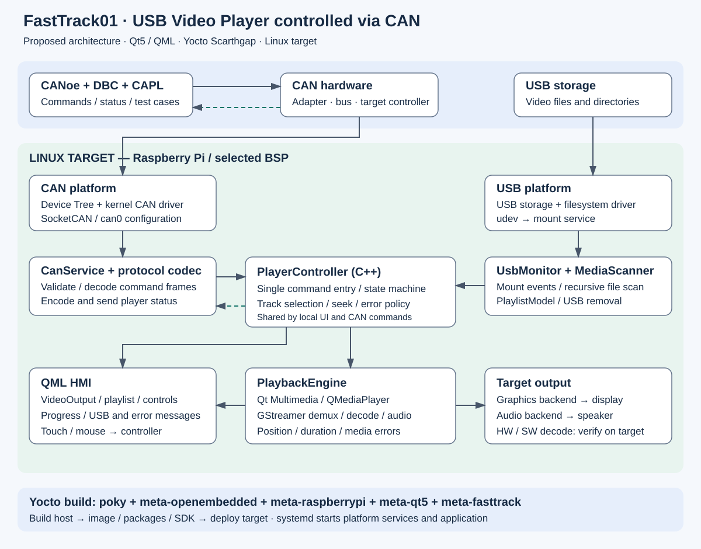

# FastTrack01 — Tổng quan phần mềm và hướng triển khai

## 1. Mục tiêu và nguồn yêu cầu

FastTrack01 xây dựng thiết bị Linux nhúng phát video từ USB, có giao diện Qt5/QML và nhận điều khiển qua CAN. Demo hoàn chỉnh: khởi động target → cắm USB → tạo playlist → phát video → CANoe điều khiển và nhận trạng thái.

Nguồn yêu cầu chính: `../OJT_USB_Video_Player_CAN_Qt5_QML.pptx`, gồm 11 slide. Tài liệu này diễn giải yêu cầu và đề xuất cách triển khai; không khẳng định các module bên dưới đã hoàn thành.

Baseline hiện tại theo xác nhận của chủ dự án: **Yocto Scarthgap**, `core-image-minimal` đã build thành công và Qt5 đang được build. Cấu hình tools hiện chọn `raspberrypi3-64`. Các mô tả Kirkstone trong tài liệu baseline cũ không áp dụng cho baseline này. ESP32/Web Dashboard là hướng mở rộng có nhắc trong tài liệu cũ, chưa thay thế yêu cầu CANoe trong slide OJT.

## 2. Sơ đồ software block



Mũi tên liền biểu diễn luồng chính của sự kiện, lệnh và media. Mũi tên đứt biểu diễn phản hồi trạng thái về CANoe. Sơ đồ mô tả quan hệ chức năng, không có nghĩa mỗi khối phải là một process hoặc thread riêng.

**Build host** là máy Windows/WSL dùng Yocto để tạo image. **Target** là bo Raspberry Pi chạy image, kết nối màn hình, USB và CAN. **CANoe host** là máy Windows chạy CANoe và adapter CAN; có thể chính là máy build nhưng giữ vai trò khác. SocketCAN trên target cần driver/controller thật; build thành công không chứng minh bus CAN hoặc giải mã video đã hoạt động.

## 3. Chức năng từng khối

| Khối | Trách nhiệm | Đầu vào → đầu ra | Cách triển khai đề xuất |
|---|---|---|---|
| Yocto / meta-fasttrack | Tạo hệ điều hành và đóng gói tùy biến | Recipe, config, source → image/packages/SDK | Image append; recipe ứng dụng; recipe cấu hình CAN, USB và systemd; BSP append cho kernel/DTS |
| CAN platform | Đưa controller thành interface `can0` | CAN controller, SPI/IRQ/clock nếu dùng SPI → SocketCAN | Chốt phần cứng; enable kernel config và DTS; service/network config đặt bitrate và restart policy |
| CanService | Giao tiếp bus và kiểm tra frame | Frame nhận → lệnh; snapshot player → frame status | Qt SerialBus với plugin SocketCAN hoặc native SocketCAN; chọn một cách để tránh trùng logic |
| ProtocolCodec | Tách giao thức khỏi playback | CAN ID, DLC, payload → command có kiểu dữ liệu | Validate ID, độ dài, command, giá trị, counter và checksum nếu được chốt |
| USB platform | Phát hiện storage và mount filesystem | Hotplug/block device → mount point sử dụng được | udev kích hoạt service mount hoặc daemon mount; không chạy tác vụ dài trực tiếp trong udev rule |
| UsbMonitor | Theo dõi vòng đời USB | Add/remove và trạng thái mount → sự kiện ứng dụng | libudev hoặc theo dõi dịch vụ mount; chỉ scan khi mount đã sẵn sàng; watcher thư mục đơn thuần không thay thế hotplug/mount |
| MediaScanner | Tìm các file ứng viên | Mount point → danh sách file | Worker quét đệ quy, lọc định dạng; hủy được khi rút USB; không đi theo symlink ra ngoài USB |
| PlaylistModel | Cung cấp danh sách cho UI | Kết quả scan → model, current index | `QAbstractListModel` với tên, URL, trạng thái; cập nhật model tại thread sở hữu model |
| PlayerController | Điều phối mọi thao tác | Lệnh UI/CAN và sự kiện media/USB → thay đổi player | QObject với slot/command chung, kiểm tra state và giới hạn seek; phát signal cập nhật UI/status |
| PlaybackEngine | Thực hiện phát media | URL, play/pause/seek → video/audio, position/error | C++ `QMediaPlayer` làm chủ playback; QML `VideoOutput` nối vào engine qua API phù hợp; tránh tạo thêm player độc lập trong QML |
| Qt Multimedia / GStreamer | Đọc container và giải mã | File USB → video frame/audio | Chọn demuxer, parser, decoder và sink theo target; thử MP4/H.264 bằng pipeline trước khi tích hợp Qt |
| QML HMI | Hiển thị và nhận thao tác người dùng | Model/state → giao diện; click/touch → controller | Video area, playlist, highlight, play/pause, next/previous, seek, thời gian, empty/error/USB removed |
| CANoe / DBC / CAPL | Điều khiển và kiểm thử | Panel/test case → command; status → hiển thị/evidence | DBC thống nhất với codec; CAPL tạo frame, command lỗi, kiểm tra timeout và trạng thái |
| systemd | Khởi động và quản lý dịch vụ | Boot/service dependency → ứng dụng chạy | Chuẩn bị CAN, USB và môi trường display; log qua journal; ứng dụng vẫn sống khi chưa có USB |

## 4. Các luồng hoạt động

### 4.1 Khi khởi động

1. Kernel nạp driver CAN, USB, filesystem, graphics và audio.
2. systemd khởi động các dịch vụ nền, cấu hình `can0` và dịch vụ mount USB.
3. Service ứng dụng chọn backend display đã kiểm chứng: EGLFS hoặc Wayland; X11 cũng là lựa chọn trong yêu cầu gốc. Cấu hình service hiện có chọn EGLFS nhưng cần xác nhận trên target.
4. Ứng dụng tạo controller, model và UI; kiểm tra cả USB đã cắm sẵn trước khi app chạy.
5. Không có USB: UI hiển thị chờ USB. CAN lỗi: hiển thị tình trạng CAN, không tự động làm ứng dụng crash.

### 4.2 Khi cắm USB

1. Kernel tạo block device và udev phát sự kiện.
2. Mount service nhận diện phân vùng và filesystem được hỗ trợ, mount vào vị trí quy ước.
3. UsbMonitor xác nhận mount thành công, chuyển ứng dụng sang SCANNING.
4. MediaScanner quét đệ quy ở worker; gửi kết quả kèm mã phiên USB để bỏ kết quả cũ nếu USB đã thay đổi.
5. PlaylistModel nhận danh sách hợp lệ. Có video thì chọn mục đầu và phát theo demo yêu cầu; không có thì hiển thị playlist rỗng.
6. PlaybackEngine mở file; GStreamer xử lý container/codec; UI hiển thị hình, thời lượng và vị trí.

Phần mở rộng file chỉ là bộ lọc ứng viên. File `.mp4` vẫn có thể chứa codec chưa hỗ trợ hoặc bị hỏng; engine phải xử lý lỗi khi mở/phát.

### 4.3 Khi nhận lệnh CAN hoặc thao tác UI

1. CanService nhận frame và ProtocolCodec kiểm tra tính hợp lệ.
2. Lệnh hợp lệ chuyển thành thao tác có kiểu dữ liệu: Play, Pause, Next, Previous, Forward hoặc Backward.
3. PlayerController xử lý qua cùng API với nút bấm QML, giúp UI và CAN có cùng hành vi.
4. Controller điều khiển engine; trạng thái xác nhận từ engine cập nhật UI và snapshot status.
5. CanService đóng gói status trả về CANoe theo chu kỳ hoặc khi thay đổi, sau khi chốt protocol.

Next/Previous ở cuối/đầu playlist cần có quy tắc thống nhất. Đề xuất playlist loop theo yêu cầu test. Seek dùng vị trí mới giới hạn trong `[0, duration]`; chỉ thực hiện khi media có thể seek. Counter lặp cần được xử lý để tránh Next hoặc seek hai lần ngoài ý muốn.

### 4.4 Khi rút USB hoặc gặp lỗi

1. Đánh dấu phiên USB không còn hợp lệ và hủy scan đang chạy.
2. Dừng playback, giải phóng nguồn media, xóa playlist/current item và hiện thông báo USB removed.
3. Cập nhật status gửi CANoe; giữ app hoạt động để nhận lần cắm tiếp theo.
4. Với eject chủ động, dừng đọc trước khi unmount. Rút vật lý đột ngột không thể đảm bảo unmount sạch; ứng dụng phải chịu được I/O error và không giữ state PLAYING giả.
5. File lỗi: hiển thị lỗi; chính sách bỏ qua file hoặc chờ lệnh cần chốt. Bus-off: ghi log và phục hồi theo CAN policy, không xóa playlist chỉ vì mất CAN.

## 5. Trạng thái và giao thức cần thống nhất

Trạng thái nội bộ đề xuất: `NO_USB`, `SCANNING`, `READY`, `PLAYING`, `PAUSED`, `ERROR`. Đây là thiết kế đề xuất, không phải enum đã được slide quy định. Khi phát xong một file, chọn mục tiếp theo và xử lý loop; nếu playlist hết khả năng phát thì báo lỗi thay vì thử vô hạn.

Tách **trạng thái USB**, **playback** và **CAN health**. Ví dụ CAN timeout không đồng nghĩa media bị lỗi; USB rút thì playback dừng nhưng app vẫn chạy. Protocol phải quy định cách ánh xạ trạng thái nội bộ về `STOPPED / PLAYING / PAUSED / ERROR` trong slide.

| Nội dung | Yêu cầu từ slide | Việc phải chốt trước khi viết codec/DBC |
|---|---|---|
| Command frame | Đề xuất CAN ID `0x100`, 6 lệnh điều khiển | Standard/extended ID, DLC, mapping byte; slide tách Command/Seek còn cần làm rõ |
| Status frame | Đề xuất CAN ID `0x101` | Độ rộng index/time, đơn vị, endian, giá trị invalid; chia frame nếu không đủ payload |
| Seek | Forward/Backward, giá trị bước hoặc tốc độ | Chọn nghĩa cụ thể; đề xuất bước thời gian cho bản đầu |
| Rolling counter | Có counter trong đề xuất | Bit width, wrap, reset sau reconnect, xử lý frame trùng/mất |
| Checksum | Tùy chọn | Có dùng hay không; nếu có, thuật toán và vùng byte được tính |
| Timeout/status cycle | Có test timeout, chưa có chu kỳ cố định | Chu kỳ phát, ngưỡng timeout, hành vi mất liên lạc và recovery |
| Bus | Có TX/RX và bus-off test | Controller, oscillator, bitrate, termination và adapter CANoe |

Không tự gán 500 kbit/s, status 100 ms hoặc một checksum cụ thể thành yêu cầu bắt buộc. Chỉ đưa các giá trị này vào code sau khi chốt spec chung giữa target và CANoe.

## 6. Tổ chức code và cách thực hiện

### 6.1 Phân chia source đề xuất

```text
App/
  CMakeLists.txt
  src/
    main.cpp
    PlayerController.{h,cpp}
    PlaybackEngine.{h,cpp}
    PlaylistModel.{h,cpp}
    UsbMonitor.{h,cpp}
    MediaScanner.{h,cpp}
    CanService.{h,cpp}
    ProtocolCodec.{h,cpp}
  qml/
    Main.qml
    PlaylistView.qml
    PlayerControls.qml
  resources.qrc
CANoe_Simulation/
  # DBC, panel, CAPL và test evidence
Yocto/meta-fasttrack/
  conf/layer.conf
  recipes-core/images/core-image-minimal.bbappend
  recipes-apps/fasttrack-video-player/
  # Thêm recipe cho CAN/USB service và BSP config khi đã chốt
```

Đây là cấu trúc đề xuất. Recipe hiện tại còn dùng source trong `files/src`, nên cần chọn một nguồn chuẩn khi chuyển sang source thật: recipe lấy source repo/subdirectory hoặc giữ source trong recipe; tránh duy trì hai bản ứng dụng khác nhau.

### 6.2 Nguyên tắc event loop và thread

- GUI, PlayerController và PlaylistModel cập nhật trên Qt main thread.
- Media scan chạy worker; trả dữ liệu qua queued signal, không trực tiếp sửa QML/model từ worker.
- CAN có thể dùng API event-driven của Qt SerialBus trên event loop; chỉ cần thread riêng khi thiết kế I/O yêu cầu. Không block GUI để chờ frame.
- Thống nhất sở hữu object playback; callback lỗi, duration và position đi về controller/UI bằng signal.
- Khi USB thay đổi, dùng generation/session ID để bỏ kết quả scan hoặc callback đã lỗi thời.

### 6.3 Các bước triển khai có điểm kiểm chứng

| Bước | Việc thực hiện | Điều kiện hoàn thành |
|---|---|---|
| 1. Baseline | Giữ pin Scarthgap, build minimal, deploy và boot target | Boot log, console login và cấu hình machine rõ ràng |
| 2. Qt graphics | Đưa runtime vào image, chạy QML đơn giản, chốt EGLFS/Wayland | UI hiển thị đúng trên màn hình target; input hoạt động |
| 3. Multimedia | Kiểm tra GStreamer với video mẫu; xác nhận decoder/audio rồi thử Qt Multimedia | MP4/H.264 phát ổn định; ghi rõ HW/SW decode, CPU/RAM |
| 4. Player local | C++ controller/model/engine và QML, test bằng file local | 6 thao tác hoạt động, seek boundary và video lỗi được xử lý |
| 5. USB | Driver filesystem + hotplug + mount + scan + removal | Cắm trước/sau boot đều hoạt động; rút trong scan/play không crash |
| 6. CAN platform | Chốt phần cứng, kernel config, DTS, bitrate và restart policy | `candump`/`cansend` xác nhận TX/RX; bus-off/restart có evidence |
| 7. CAN app | Chốt DBC/spec, codec và CanService nối controller | CANoe điều khiển đúng và nhận status; invalid/duplicate/timeout có test |
| 8. Deployment | Sửa recipe ứng dụng, đóng gói source/service, enable tự chạy | Flash image mới là chạy được, không phụ thuộc lệnh thủ công |
| 9. Acceptance | Playlist loop, chạy dài, kiểm tra RSS/CPU, lỗi USB/CAN/media | Test report, logs, ảnh và demo tái hiện được |

Ở bước codec, có thể kiểm thử logic thuần và dùng `vcan` để tích hợp trước khi có phần cứng; kết quả này không thay cho test CAN vật lý hoặc bus-off thật.

## 7. Tình trạng repo quan sát được và việc còn thiếu

| Hạng mục | Tình trạng tại thời điểm soạn |
|---|---|
| Minimal image | Chủ dự án xác nhận build thành công trên Scarthgap; chưa có xác nhận boot target trong hội thoại |
| Qt5 build | Chủ dự án xác nhận đang build; chưa có xác nhận playback trên target |
| Image append | Đã tạo `recipes-core/images/core-image-minimal.bbappend` thêm runtime Qt/QML/multimedia, GStreamer base/good và công cụ CAN/USB; chưa xác nhận build rootfs sau thay đổi |
| Ứng dụng | `files/src/main.c` hiện chỉ in thông báo và TODO; CMake đang khai báo ngôn ngữ C, chưa phải Qt C++/QML player |
| Recipe ứng dụng | `do_install` dùng `${WORKDIR}/setup_can.sh` nhưng file chưa được đưa vào `SRC_URI`; cần sửa trước khi thêm app vào image |
| CAN setup | `setup_can.sh` mới là placeholder, chưa cấu hình interface |
| systemd app | Đã có service mẫu chọn EGLFS và gọi CAN setup; chưa chứng minh display environment hay service dependency đúng trên target |
| USB, protocol, test | Các khối trong tài liệu là kế hoạch triển khai; chưa xác minh phần thực thi khác trong repo |

Chỉ thêm package runtime không tự enable kernel driver, mount USB hay đảm bảo codec H.264. GStreamer cần đúng plugin/package và cấu hình build; HW decode phụ thuộc SoC, kernel, backend và BSP. Cần kiểm chứng trên target thay vì suy ra từ việc Qt build thành công.

## 8. Kiểm tra và nghiệm thu

Từ shell đã source môi trường Yocto, kiểm tra append rồi build image; không cần clean toàn bộ chỉ vì thêm package:

```bash
bitbake-layers show-appends
bitbake core-image-minimal
```

Theo dõi dung lượng ổ Windows chứa VHDX trong quá trình build. Dung lượng logic trống trong WSL không đảm bảo host còn đủ chỗ.

Trên target, dùng `ip -details -statistics link show can0`, `candump can0` và log kernel để chẩn đoán CAN; chỉ gửi frame sau khi chốt bitrate/protocol và kết nối bus đúng. Dùng log ứng dụng/systemd để kiểm tra playback và hotplug.

Checklist nghiệm thu bám slide 8 và 10:

- CAN TX/RX đúng bitrate, boot ổn định và phục hồi bus-off.
- USB được nhận/mount/scan, thư mục rỗng được xử lý; rút khi đang phát không crash.
- Phát MP4/H.264, playlist loop, tua tại biên và file hỏng có hành vi rõ ràng.
- CANoe kiểm tra đủ 6 lệnh, frame lặp, lệnh sai, timeout và phản hồi.
- Chạy dài với thời lượng do nhóm thống nhất; ghi CPU/RSS, lỗi, restart và dấu hiệu leak.
- Bàn giao source driver/DTS/C++/QML/CAPL, architecture, DBC/protocol, state machine, build/deploy guide, test report, demo và known issues.

## 9. Các quyết định tiếp theo

1. Xác nhận target và CAN controller/oscillator/transceiver thực tế; kiểm tra điện áp và sơ đồ kết nối theo phần cứng.
2. Chốt display backend và video mẫu/codec bắt buộc; đo decoder trên target.
3. Chốt USB filesystem, mount policy và hành vi nhiều USB; bản đầu có thể chỉ hỗ trợ một USB nếu được thống nhất.
4. Chốt command/status spec rồi cập nhật cùng lúc codec, DBC và CAPL.
5. Sửa recipe ứng dụng và chuyển skeleton C sang C++/Qt; hoàn thành local playback trước khi nối CAN.

## Nguồn đối chiếu

- `../OJT_USB_Video_Player_CAN_Qt5_QML.pptx`: yêu cầu chính, slide 1–11.
- `../Yocto/tools/init-build.sh`, `local.conf.template`: baseline Scarthgap và machine cấu hình.
- `../Yocto/meta-fasttrack/conf/layer.conf`: layer dependencies và đường dẫn recipe.
- `../Yocto/meta-fasttrack/recipes-core/images/core-image-minimal.bbappend`: package runtime hiện bổ sung.
- `../Yocto/meta-fasttrack/recipes-apps/fasttrack-video-player/`: skeleton source, recipe, service và CAN setup hiện có.
- `../PROJECT_BASELINE_AND_GUIDE.md`: tài liệu tham khảo cũ; các khác biệt Kirkstone/ESP32 cần được hòa giải riêng, không tự áp dụng thay yêu cầu slide.
