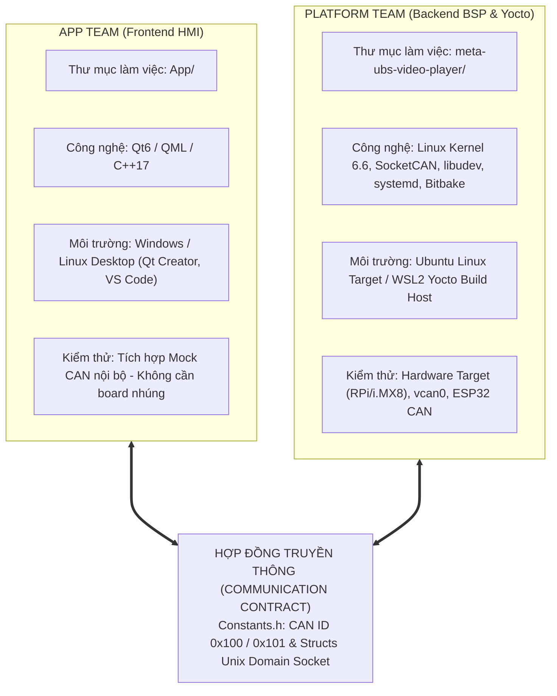
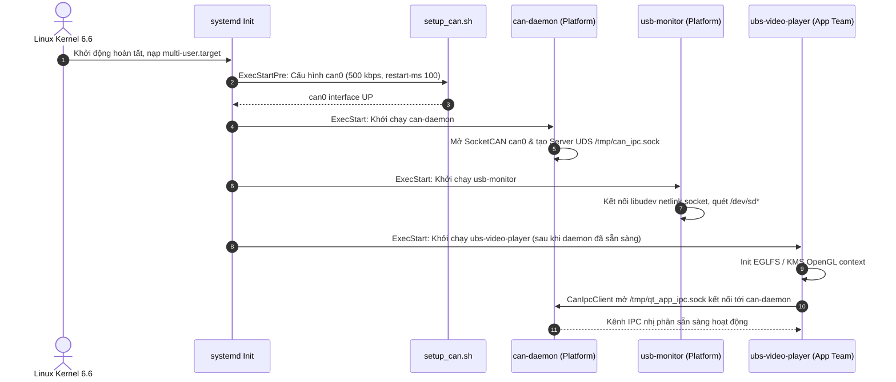
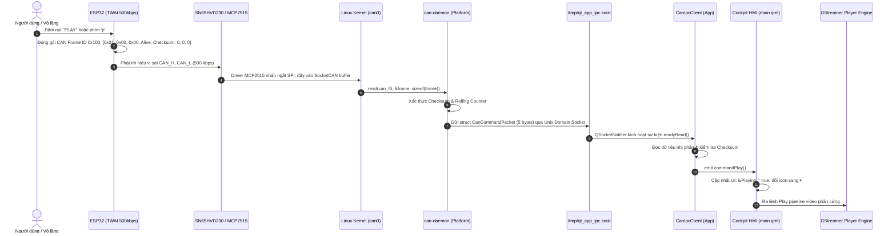
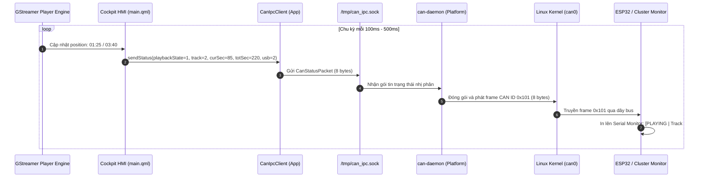
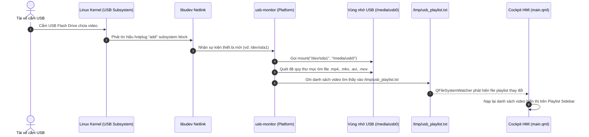

# CẨM NANG TOÀN DIỆN: KIẾN TRÚC DỰ ÁN, PHÂN CHIA 2 TEAM (APP & PLATFORM), BUILD YOCTO SCARTHGAP VÀ GIẢ LẬP CAN ESP32

> **Tên dự án:** Embedded Automotive USB Video Player Controlled via CAN Bus  
> **Hệ điều hành nhúng:** Linux Yocto Scarthgap (Poky 5.0 LTS - Kernel 6.6 LTS, Hỗ trợ đến 2028)  
> **Nền tảng HMI:** Qt6 / QML chạy trực tiếp trên EGLFS / Linux KMS (Hardware Accelerated)  
> **Giao thức mạng xe:** SocketCAN (can0 @ 500 kbps, DBC đồng bộ 100%)  
> **Cơ chế IPC:** Unix Domain Socket (UDS) & File State IPC (Zero-overhead, thay thế hoàn toàn D-Bus)  

---

## 1. CẤU TRÚC THƯ MỤC DỰ ÁN (PROJECT TREE FOLDER)

Dự án được tái cấu trúc tinh gọn theo mô hình cộng tác chuẩn công nghiệp ô tô: **Phân chia 2 Team độc lập (App Team & Platform Team)**. Thay vì tạo thêm thư mục `Platform` rời rạc gây phân mảnh mã nguồn, toàn bộ mã nguồn nền tảng (Platform Daemons, Cấu hình Kernel/SocketCAN, Systemd Services và Công thức đóng gói Yocto) được **hợp nhất trực tiếp vào `meta-ubs-video-player`**.

```text
FastTrack01/
├── App/                                      <-- [TẦNG ỨNG DỤNG - DÀNH RIÊNG CHO APP TEAM (QT6/QML HMI)]
│   ├── CMakeLists.txt                        <-- CMake build Qt App (hỗ trợ cả Qt5 & Qt6, Mock tự động trên Windows)
│   ├── common/
│   │   └── Constants.h                       <-- Hợp đồng truyền thông (CAN ID, Struct IPC nhị phân)
│   ├── src/
│   │   ├── main.cpp                          <-- Điểm khởi động HMI, inject CanIpcClient vào QML context
│   │   └── CanClient/
│   │       ├── CanIpcClient.h                <-- Client kết nối can-daemon qua UDS (tích hợp Mock cho App Dev)
│   │       └── CanIpcClient.cpp              <-- Giải mã gói tin nhị phân và phát tín hiệu Qt Signals
│   └── qml/
│       ├── main.qml                          <-- Giao diện Cockpit Cyberpunk HUD (Video player, playlist, status)
│       └── qml.qrc                           <-- File tài nguyên Qt Resource đóng gói QML
│
├── meta-ubs-video-player/                    <-- [TẦNG NỀN TẢNG - DÀNH RIÊNG CHO PLATFORM TEAM (YOCTO LAYER & DAEMONS)]
│   ├── conf/
│   │   └── layer.conf                        <-- Khai báo Yocto Layer tương thích Scarthgap (Poky 5.0 LTS)
│   │
│   ├── recipes-platform/                     <-- Mã nguồn & Bitbake recipes các daemon tầng thấp (System/Hardware)
│   │   ├── common/
│   │   │   └── files/
│   │   │       └── Constants.h               <-- Header gốc chuẩn định nghĩa Protocol CAN & Struct UDS IPC
│   │   ├── can-daemon/                       <-- Dịch vụ SocketCAN can0 bridge
│   │   │   ├── can-daemon_1.0.bb             <-- Bitbake recipe build can-daemon & systemd unit
│   │   │   └── files/
│   │   │       ├── CMakeLists.txt            <-- CMake cấu hình biên dịch C++17
│   │   │       ├── can-daemon.service        <-- Systemd unit file tự động khởi chạy can-daemon
│   │   │       ├── setup_can.sh              <-- Script bring-up can0 (500 kbps, restart-ms 100)
│   │   │       └── src/
│   │   │           └── main.cpp              <-- Đọc can0, validate checksum, phát qua Unix Domain Socket
│   │   └── usb-monitor/                      <-- Dịch vụ giám sát Hotplug USB & Quét Media
│   │       ├── usb-monitor_1.0.bb            <-- Bitbake recipe build usb-monitor (phụ thuộc libudev)
│   │       └── files/
│   │           ├── CMakeLists.txt            <-- CMake cấu hình biên dịch C++17 + libudev
│   │           ├── usb-monitor.service       <-- Systemd unit file tự động khởi chạy usb-monitor
│   │           └── src/
│   │               └── main.cpp              <-- libudev lắng nghe cắm/rút USB, auto-mount, quét MP4/MKV
│   │
│   ├── recipes-app/                          <-- Recipe đóng gói tầng Ứng dụng HMI từ App/
│   │   └── ubs-video-player/
│   │       ├── ubs-video-player_1.0.bb       <-- Recipe kéo source App/ biên dịch Qt HMI (qtbase, qtmultimedia)
│   │       └── files/
│   │           └── ubs-video-player.service  <-- Systemd unit file khởi chạy HMI EGLFS tự động khi boot
│   │
│   └── recipes-core/
│       └── images/
│           └── ubs-image.bb                  <-- Image Yocto DUY NHẤT đóng gói toàn bộ hệ thống
│
├── Simulation/                               <-- [CÔNG CỤ GIẢ LẬP CAN ĐIỀU KHIỂN & TESTING]
│   ├── esp32-can-simulator/
│   │   └── esp32_can_transmitter.ino         <-- Code nạp ESP32 TWAI (CAN bus) + Serial Controller
│   └── scripts/
│       └── simulate_can_sender.py            <-- Script Python giả lập phát SocketCAN trên máy tính dev
│
├── References/                               <-- Thư mục lưu trữ tài nguyên gốc (App mẫu, DBC, DTS, tài liệu)
│   ├── App/                                  <-- Source App mẫu nguyên bản
│   ├── CANoe_Simulation/                     <-- Database CAN (.dbc) và mô phỏng CANoe
│   ├── Hardware_BSP/                         <-- DTS overlay, kernel config cho MCP2515
│   └── PROJECT_BASELINE_AND_GUIDE.md         <-- Tài liệu baseline ban đầu
│
└── YOCTO_SCARTHGAP_GUIDE.md                  <-- Cẩm nang hướng dẫn toàn diện này
```

---

## 2. PHÂN CHIA TRÁCH NHIỆM 2 TEAM (APP TEAM VS PLATFORM TEAM)

Mô hình phân tách này giải quyết triệt để vấn đề phụ thuộc chéo giữa giao diện người dùng và hệ thống phần cứng, tối ưu hóa quy trình làm việc song song:



### 2.1. App Team (`App/`)
* **Phạm vi trách nhiệm:**
  - Thiết kế và phát triển giao diện người dùng HMI Cockpit trên [App/qml/main.qml](file:///d:/04_PROJECT/FastTrack01/App/qml/main.qml).
  - Tối ưu trải nghiệm phát video: Surface video tràn màn hình, visualizer sóng âm, playlist sidebar, hiển thị metadata bài hát.
  - Xử lý tương tác thông qua [CanIpcClient](file:///d:/04_PROJECT/FastTrack01/App/src/CanClient/CanIpcClient.h): tiếp nhận tín hiệu CAN đã được giải mã từ `can-daemon` và gửi trạng thái playback định kỳ 500ms.
* **Quyền độc lập hoàn toàn:**
  - Không cần máy ảo Yocto hay máy chủ Linux.
  - Không cần board mạch nhúng hay phần cứng CAN vật lý.
  - Có thể mở trực tiếp thư mục [App/](file:///d:/04_PROJECT/FastTrack01/App) bằng Qt Creator trên máy Windows cá nhân và nhấn `Run` để test giao diện ngay lập tức với chế độ Mock CAN tự sinh dữ liệu.

### 2.2. Platform Team (`meta-ubs-video-player/`)
* **Tại sao `meta-ubs-video-player` là Platform duy nhất?**
  - Trong các dự án nhúng, việc tạo thêm một folder `Platform/` song song với layer Yocto dẫn đến tình trạng "phân mảnh mã nguồn" (fragmentation): Platform team phải duy trì 2 nơi, vừa phải viết code trong `Platform/`, vừa phải viết công thức Bitbake trong `meta-ubs-video-player/`.
  - Hợp nhất toàn bộ vào `meta-ubs-video-player/`:
    1. **Tự chứa (Self-contained):** Mã nguồn các daemon (`can-daemon`, `usb-monitor`), scripts bring-up và systemd service nằm trọn vẹn trong `recipes-platform/`.
    2. **Độc lập biên dịch:** Mã nguồn daemon có file `CMakeLists.txt` chuẩn, có thể biên dịch trực tiếp trên Linux target bằng CMake thường (`cmake -B build && cmake --build build`) hoặc biên dịch tự động qua Bitbake.
    3. **Đóng gói chuẩn Yocto:** Cung cấp sẵn file `ubs-image.bb` để tạo ra một image Linux OS hoàn chỉnh nạp trực tiếp vào thẻ nhớ.
* **Phạm vi trách nhiệm:**
  - Cấu hình phần cứng: Device Tree overlay cho chip SPI CAN MCP2515, cấu hình Kernel driver SocketCAN.
  - Viết và duy trì 2 daemon hệ thống:
    - `can-daemon`: Giao tiếp SocketCAN vật lý `can0` (500 kbps) -> giải mã khung tin CAN `0x100` -> gửi qua Unix Domain Socket.
    - `usb-monitor`: Lắng nghe kernel qua Netlink socket (`libudev`) -> tự động mount phân vùng USB vào `/media/usb0` -> quét tìm file video (`.mp4`, `.mkv`, `.avi`) -> cập nhật file trạng thái `/tmp/usb_playlist.txt`.
  - Quản lý các file unit `systemd` để điều phối thứ tự khởi động mượt mà khi bật nguồn xe.

---

## 3. CƠ CHẾ IPC: TẠI SAO CHỌN UNIX DOMAIN SOCKET (UDS) THAY CHO D-BUS?

| Tiêu chí so sánh | D-Bus (Hệ thống cũ) | Unix Domain Socket (Hệ thống mới) |
| :--- | :--- | :--- |
| **Độ phức tạp cấu hình** | Rất cao: Cần viết file XML Introspection, cấp file quyền `/etc/dbus-1/system.d/*.conf`, chạy D-Bus Daemon daemon | **Cực kỳ thấp:** Không cần config XML hay cấp quyền phức tạp. Sử dụng API socket chuẩn POSIX C/C++ |
| **Thư viện phụ thuộc** | Bắt buộc cài thêm `dbus`, `sdbus-c++` hoặc module `QtDBus` làm tăng kích thước Image | **Zero-dependency:** Tận dụng trực tiếp kernel Linux và `QSocketNotifier` có sẵn trong Qt Core |
| **Hiệu năng & Độ trễ** | Phải parse chuỗi string, marshalling/unmarshalling dữ liệu qua D-Bus Daemon bus trung gian | **Siêu tốc:** Truyền trực tiếp struct nhị phân (Zero Serialization Overhead). Độ trễ < 0.1ms |
| **Kích thước gói tin** | Header D-Bus cồng kềnh | Đúng **5 bytes** (lệnh điều khiển) và **8 bytes** (telemetry trạng thái) |
| **Khả năng Debug** | Cần tool chuyên dụng (`busctl`, `dbus-monitor`) | Debug cực nhanh chỉ với 1 lệnh terminal: `nc -U /tmp/can_ipc.sock` |

### Cấu trúc gói tin nhị phân IPC (Đồng bộ trong `Constants.h`):

Header chuẩn được lưu tại [meta-ubs-video-player/recipes-platform/common/files/Constants.h](file:///d:/04_PROJECT/FastTrack01/meta-ubs-video-player/recipes-platform/common/files/Constants.h) và sao lưu tại [App/common/Constants.h](file:///d:/04_PROJECT/FastTrack01/App/common/Constants.h):

```cpp
// 1. Gói tin Lệnh từ can-daemon gửi đến Qt App (5 Bytes)
#pragma pack(push, 1)
struct CanCommandPacket {
    uint8_t commandId;           // PlayerCommand: 1: Play, 2: Pause, 3: Next, 4: Prev
    uint8_t seekCommand;         // SeekCommand: 5: Fast Forward, 6: Fast Backward
    uint8_t seekStepValue;       // Bước nhảy tua (5s, 10s...)
    uint8_t rollingCounter;      // 0..15 chống duplicate frame
    uint8_t checksum;            // (Byte0 + Byte1 + Byte2 + Byte3) mod 256
};

// 2. Gói tin Trạng thái từ Qt App phản hồi cho can-daemon để phát lên CAN bus (8 Bytes)
struct CanStatusPacket {
    uint8_t  playbackState;      // 0: Stopped, 1: Playing, 2: Paused, 3: Error
    uint8_t  trackIndex;         // Index bài hát hiện tại (0..255)
    uint16_t curTimeSec;         // Giây hiện tại (Big Endian khi gửi CAN)
    uint16_t totalDurationSec;   // Tổng thời lượng (Big Endian khi gửi CAN)
    uint8_t  usbHealth;          // 0: Disconnected, 1: Scanning, 2: Ready
    uint8_t  aliveCounter;       // Heartbeat counter (0..255)
};
#pragma pack(pop)
```

---

## 4. LUỒNG HOẠT ĐỘNG TOÀN HỆ THỐNG (SEQUENCE & DATA FLOW)

### 4.1. Luồng 1: Khởi động hệ thống (System Boot Sequence)

Khi bo mạch nhúng bật nguồn, `systemd` điều phối khởi động các dịch vụ theo thứ tự phụ thuộc chính xác:



---

### 4.2. Luồng 2: Điều khiển CAN từ ESP32 đến Giao diện Qt Video Player

Khi người dùng nhấn nút trên vô lăng (hoặc phím điều khiển trên bộ giả lập ESP32):



---

### 4.3. Luồng 3: Phản hồi Telemetry từ Qt App ngược về CAN Bus

Để các đồng hồ táp-lô (Cluster) hoặc thiết bị khác trên xe nắm được tiến độ bài hát:



---

### 4.4. Luồng 4: Cắm rút USB Flash Drive & Cập nhật Danh sách Video



---

## 5. HƯỚNG DẪN BUILD YOCTO SCARTHGAP (POKY 5.0 LTS)

### 5.1. Chuẩn bị máy chủ Build (Ubuntu 22.04 / 24.04 LTS hoặc WSL2)
Cài đặt các gói phụ thuộc bắt buộc:
```bash
sudo apt-get update && sudo apt-get install -y \
    gawk wget git diffstat unzip texinfo gcc build-essential \
    chrpath socat cpio python3 python3-pip python3-pexpect \
    xz-utils debianutils iputils-ping python3-git python3-jinja2 \
    libegl1-mesa libsdl1.2-dev pylint xterm zstd liblz4-tool
```

### 5.2. Tải mã nguồn Poky & các Layers phụ thuộc
```bash
mkdir -p ~/yocto-scarthgap && cd ~/yocto-scarthgap

# 1. Clone Core Poky Scarthgap
git clone -b scarthgap git://git.yoctoproject.org/poky.git poky

# 2. Clone meta-openembedded
git clone -b scarthgap git://git.openembedded.org/meta-openembedded

# 3. Clone meta-qt6
git clone -b scarthgap https://code.qt.io/yocto/meta-qt6.git

# 4. Liên kết meta-layer dự án (Platform repository)
ln -s /path/to/FastTrack01/meta-ubs-video-player ./meta-ubs-video-player
```

### 5.3. Khởi tạo môi trường Yocto
```bash
source poky/oe-init-build-env build
```

### 5.4. Đăng ký các Layer vào `conf/bblayers.conf`
Chạy lệnh tự động đăng ký các layer:
```bash
bitbake-layers add-layer ../meta-openembedded/meta-oe
bitbake-layers add-layer ../meta-openembedded/meta-python
bitbake-layers add-layer ../meta-openembedded/meta-networking
bitbake-layers add-layer ../meta-qt6
bitbake-layers add-layer ../meta-ubs-video-player
```

### 5.5. Cấu hình tối ưu trong `conf/local.conf`
Mở file `conf/local.conf` và thêm các dòng cấu hình sau vào cuối file:

```conf
# Sử dụng systemd làm init system
INIT_MANAGER = "systemd"

# Bật tính năng đồ họa tăng tốc phần cứng cho Qt6 trên bo nhúng
PACKAGECONFIG:append:pn-qtbase = " eglfs gstreamer kms gles2"
PACKAGECONFIG:append:pn-qtmultimedia = " gstreamer"

# Hỗ trợ CAN bus kernel driver (MCP2515 SPI CAN)
IMAGE_INSTALL:append = " kernel-module-mcp251x can-utils"

# Cho phép phần mềm độc quyền / codec thương mại (nếu cần play H.264/AAC)
LICENSE_FLAGS_ACCEPTED = "commercial"
```

### 5.6. Biên dịch Image duy nhất
Chạy lệnh bitbake để build image:
```bash
bitbake ubs-image
```
*Thời gian build lần đầu: khoảng 1.5 - 3 tiếng tùy thuộc CPU và tốc độ mạng.*  
*File ảnh hoàn tất sẽ nằm tại:* `tmp/deploy/images/<machine>/ubs-image-<machine>.rootfs.wic.bz2`

---

## 6. GIẢI PHÁP STREAM VÀ PHÁT VIDEO TRÀN MÀN HÌNH TRÊN QT

Để video phát mượt mà (60 FPS, CPU < 15%) trên màn hình ô tô:
1. **Không dùng X11 / Wayland:**  
   Trong file [meta-ubs-video-player/recipes-app/ubs-video-player/files/ubs-video-player.service](file:///d:/04_PROJECT/FastTrack01/meta-ubs-video-player/recipes-app/ubs-video-player/files/ubs-video-player.service), ta đặt:
   ```ini
   Environment="QT_QPA_PLATFORM=eglfs"
   Environment="QT_QPA_EGLFS_ALWAYS_SET_MODE=1"
   ```
   Qt sẽ dùng nền tảng **EGLFS** xuất hình trực tiếp vào GPU framebuffer qua Linux DRM/KMS, loại bỏ hoàn toàn độ trễ của cửa sổ desktop.
2. **Backend GStreamer tăng tốc phần cứng:**  
   QtMultimedia tự động kết nối với các plugin `gstreamer1.0-plugins-good` và `hwcodecs` đã được đóng gói trong [ubs-image.bb](file:///d:/04_PROJECT/FastTrack01/meta-ubs-video-player/recipes-core/images/ubs-image.bb) để giải mã trực tiếp bằng phần cứng (V4L2 M2M hardware video decoder).

---

## 7. HƯỚNG DẪN GIẢ LẬP CAN BẰNG ESP32 VÀ TESTING

### 7.1. Sơ đồ đấu nối phần cứng ESP32 với bo Linux
| Chân ESP32 (TWAI) | Chân Transceiver (SN65HVD230) | Nối sang Bo Linux Target |
| :--- | :--- | :--- |
| **GPIO 4 (TX)** | **CTX** | - |
| **GPIO 5 (RX)** | **CRX** | - |
| **3V3** | **3V3 / VCC** | - |
| **GND** | **GND** | **Nối chung GND với Bo Linux** |
| - | **CAN_H** | **CAN_H của MCP2515 trên Linux** |
| - | **CAN_L** | **CAN_L của MCP2515 trên Linux** |

> **LƯU Ý CỰC KỲ QUAN TRỌNG:**
> 1. Bắt buộc phải có **điện trở 120 Ohm** mắc song song giữa chân `CAN_H` và `CAN_L`.
> 2. Bắt buộc phải **nối chung Mass (GND)** giữa nguồn ESP32 và bo mạch Linux để đồng pha tín hiệu vi sai.

### 7.2. Nạp code và điều khiển qua Serial Monitor
1. Mở file [Simulation/esp32-can-simulator/esp32_can_transmitter.ino](file:///d:/04_PROJECT/FastTrack01/Simulation/esp32-can-simulator/esp32_can_transmitter.ino) bằng Arduino IDE hoặc VS Code PlatformIO.
2. Cài đặt board ESP32 và chọn cổng COM tương ứng.
3. Nạp code và mở **Serial Monitor (Baudrate 115200)**.
4. Bấm các phím ký tự để phát lệnh CAN:
   - `p`: Gửi lệnh **PLAY**
   - `s`: Gửi lệnh **PAUSE**
   - `n`: Gửi lệnh **NEXT TRACK**
   - `b`: Gửi lệnh **PREV TRACK**
   - `f`: Gửi lệnh **TUA NHANH +10s**
   - `r`: Gửi lệnh **TUA LÙI -10s**
   - `a`: Bật/Tắt chế độ **Tự động gửi chu kỳ lệnh** mỗi 4 giây.

### 7.3. Kiểm thử trên Linux không cần phần cứng (Virtual CAN)
Nếu đang làm việc trên máy ảo Linux / PC và chưa có mạch phần cứng:
```bash
# 1. Kích hoạt module Virtual CAN
sudo modprobe vcan
sudo ip link add dev vcan0 type vcan
sudo ip link set up vcan0

# 2. Khởi chạy script Python giả lập phát lệnh
python3 Simulation/scripts/simulate_can_sender.py -i vcan0 --auto

# 3. Mở terminal kiểm tra luồng frame CAN ID 0x100
candump vcan0
```
